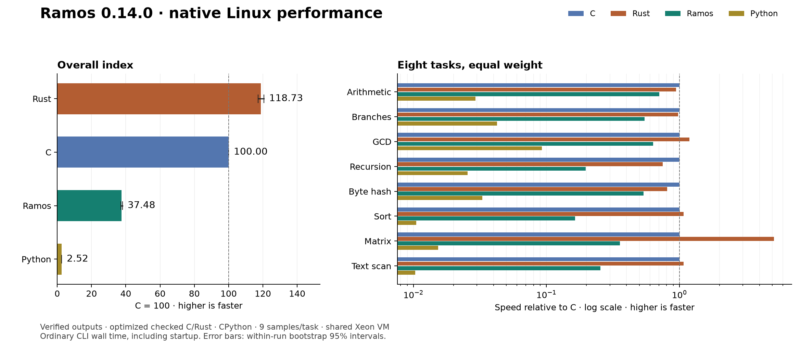

# The Ramos Book — 0.19.1

# Welcome to the Ramos Book

Ramos is a small, self-hosted language that compiles directly to native
Linux x64 and Windows x64 executables. Its two guiding rules are **simple
programming** and **measured speed**.

This book describes **Ramos 0.19.1**. Markdown chapters are the canonical edition
for AI agents, review and offline reading. The HTML edition is generated from
those same chapters for comfortable human reading. Historical version labels
identify when a feature arrived; they do not change this book's baseline.

## Choose your path

- New to Ramos? Start with [install, build and run](01-getting-started.md), then
  [the language](02-language.md) and [values](03-values.md).
- Building a tool? Read [files](06-files.md), [libraries](07-libraries.md) and
  [OS libraries](18-system.md) and [CLI/TUI](08-cli-tui.md), then try the [projects](11-cookbook.md).
- Building a desktop window? Read [desktop GUI](09-gui.md). Windows uses native
  system controls; Linux GUI requires GTK3 and a display.
- Writing Ramos with an AI agent? Start with the [agent guide](16-agent-guide.md)
  and [API reference](13-reference.md).
- Working on the compiler? Read [self-hosting](12-self-hosting.md).

## What you can use today

Checked int64 and finite float64 arithmetic, booleans, functions, comments, while/range loops, else-if chains, compound assignment, immutable
UTF-8 strings, mutable bytes, structs, typed arrays, reclaiming managed memory,
compile-time `weave`, stdin, streamed files, terminal interfaces and Windows/Linux
native GUI controls, directory iteration/creation, lexical path helpers,
environment lookup, direct child execution and reusable UTF-8 text builders.
[Text builders](20-text-builder.md) provide immutable snapshots and capacity
reuse/release for streamed tools.

[Native math](21-math.md) adds explicit conversions, square root and fixed
decimal formatting. [Decimal input](22-math-input.md) adds fallible parsing
for numerical CLI apps such as streamed statistics. There are no namespaces, networking APIs or package registry
in 0.19.1. Read
[the OS libraries](18-system.md) for directory and child-process contracts. See [the new syntax](17-easier-syntax.md) for ranges,
else-if chains and compound assignment. See the
[limits](13-reference.md) and [proposed roadmap](15-roadmap.md). Planned syntax
must not be used in programs targeting this version.

Use `ramos run app.ramos` to compile and execute a source file directly, or
`build` to save an executable. `ramos fmt` formats a copy or checks formatting.
For desktop apps, use `ramos run app.ramos --gui`; Linux CLI/compiler output
remains static. [Authoring tools](19-devtools.md) explain arguments, errors and cleanup.

## Project links

- [Compiler and source](https://github.com/zackmsa777-a11y/ramos)
- [Ramos 0.19.1 release](https://github.com/zackmsa777-a11y/ramos/releases/tag/v0.19.1)
- [Documentation source](https://github.com/zackmsa777-a11y/ramos-docs)

The limits and negative results matter as much as working features. Native
output is not proof of speed, and compiling for an OS is not proof that its
interactive applications have been tested there.


---

# Install, build and run

Use the complete
[0.19.1 GUI-dialogs bundle](https://github.com/zackmsa777-a11y/ramos/releases/download/v0.19.1/ramos-0.19.1-gui-dialogs.zip),
which also includes the CLI/TUI tools, both compilers, examples and all thirteen
libraries. Extract the archive and keep its directory structure. The published
`SHA256SUMS.txt` file lists asset hashes for integrity checking.

## Your first source file

Save `hello.ramos` as UTF-8 in the extracted directory:

```ramos
fn main() {
    print(s"Hello, Ramos!")
}
```

## Windows x64 — PowerShell

```powershell
.\ramos.exe --version
.\ramos.exe run .\hello.ramos
.\ramos.exe build .\hello.ramos -o .\hello.exe
.\hello.exe
```

Expected output: `Hello, Ramos!`. Python, a C compiler and a separate runtime
are not required for Windows/CLI programs with the downloaded compiler.
Linux `--gui` programs additionally require system GTK3 and a desktop display;
see [GUI setup](09-gui.md).

## Linux x64 — shell

```sh
chmod +x ramos-linux-x86_64
./ramos-linux-x86_64 --version
./ramos-linux-x86_64 run hello.ramos
./ramos-linux-x86_64 build hello.ramos -o hello
./hello
```

## Formatting and readable errors

```sh
./ramos-linux-x86_64 fmt hello.ramos --check
./ramos-linux-x86_64 fmt hello.ramos -o formatted-hello.ramos
```

Use `.\ramos.exe` for these commands in PowerShell. Source-line/caret errors
help locate mistakes; [authoring tools](19-devtools.md) describe formatting,
argument forwarding and temporary executable cleanup.

## Rebuilding an existing output

Use `--force` only when you intend to replace an existing executable:

```sh
./ramos-linux-x86_64 build hello.ramos -o hello --force
```

A failed compilation preserves existing output. The compiler refuses source
file aliases as output even with `--force`.

## Libraries and example folders

For a root-level source file, use `weave "stdlib/numbers.ramos"`. Sources inside
`examples/` use `weave "../stdlib/numbers.ramos"`. Paths resolve relative to the
source that contains the directive, not the terminal's working directory.

This documentation repository includes the same example and library sources.
To use them, place the downloaded native compiler at the repository root:

```sh
./ramos-linux-x86_64 build examples/library_demo.ramos -o library-demo
./library-demo
```

```powershell
.\ramos.exe build .\examples\library_demo.ramos -o .\library-demo.exe
.\library-demo.exe
```

## Build from the compiler repository

In a checkout of the main Ramos repository, initial bootstrapping on Linux
requires Make and GNU binutils. Python is used for validation, not as a runtime
for generated programs.

```sh
make
./ramos build examples/hello.ramos -o hello --force
./hello
make install PREFIX="$HOME/.local"
```

Once built, the compiler emits executables without those bootstrap tools.
Add the installation prefix's `bin` directory to `PATH` if needed. See
[self-hosting](12-self-hosting.md) for verification commands.


---

# Diagnostics, formatting and running source files

The compiler, formatter and compile-and-run driver are written in Ramos. The
native OS boundary only publishes a temporary executable, runs it and cleans up.
No interpreter, shell, Python, C compiler or separate backend is needed.

## Run a source file

Linux:

```sh
./ramos run examples/hello.ramos
./ramos run examples/rgrep.ramos -- needle README.md
```

Windows PowerShell:

```powershell
.\ramos.exe run .\examples\hello.ramos
.\ramos.exe run .\examples\rgrep.ramos -- needle README.md
```

`run SOURCE.ramos [--gui] [-- ARG...]` compiles for the OS running the compiler, using
the same checks, source-relative `weave` loading and machine-code generation as
`build`. Program arguments follow an explicit `--`; empty arguments, spaces,
Unicode, quotes and shell metacharacters remain individual values. No shell or
PATH lookup is involved. Stdin, stdout, stderr, environment and working directory
are inherited. The compiler prints nothing on success beyond the program's output.

Since 0.19, `run SOURCE.ramos --gui` selects the host GUI executable format.
For Linux this requires GTK3 and a display; Windows uses its desktop subsystem.
The optional `--gui` precedes `--` and cannot be repeated. Use `build` for
distributable executables and cross-compilation. `run` accepts no `--target`,
`-o` or `--force` and creates no output in your project.
It waits for the program and forwards exit statuses 0..255. Larger Windows
exit codes map to 1; Linux signal termination is represented as 128 plus the
signal number. Compiler, launch or cleanup failures return 1 with an error.
`arg(0)` is the temporary executable path on Linux and `ramos-run` on Windows;
user argument values start at `arg(1)` on both platforms.

The argument limit is 256 user values and 32767 packed UTF-8 bytes. Linux counts
NUL separators; Windows counts the quoted command line including its placeholder
argument zero. Embedded NUL is rejected. All existing source, code, memory and
call-depth limits remain enforced.

### Temporary executable lifetime

Compilation finishes before any temporary executable is created. Linux uses
nonempty `TMPDIR`, otherwise `/tmp`; Windows uses `GetTempPathW` (TMP, TEMP,
USERPROFILE, then the Windows directory). The base must exist and permit directory
creation and executable launch. Each run exclusively creates its own
`ramos-run-…` directory; an existing candidate is never reused. Linux permissions
are 0700. Windows directory permissions follow the base directory's security
settings. A bounded 16 attempts avoids an unbounded collision loop.

The driver atomically publishes `app.exe` inside this directory, launches it
directly, waits, deletes the executable and removes the empty directory. The
same cleanup runs after launch/write failures and handled child runtime errors.
Cleanup errors are reported. It never recursively deletes child-created files.
Abrupt compiler termination or a machine crash can leave temporary files;
crash durability and cleanup after forced termination are not promised.

## Format a file

```sh
./ramos fmt app.ramos
./ramos fmt app.ramos --check
./ramos fmt app.ramos -o formatted.ramos
./ramos fmt app.ramos -o formatted.ramos --force
```

Use `.\ramos.exe` for the same commands in PowerShell. The default writes exact
formatted UTF-8 bytes to stdout. `--check` writes nothing and returns 0 for an
unchanged file, or reports `needs formatting: FILE` and returns 1 for a change.
Read, lexical or output errors also return 1.

`-o` writes a new non-executable file atomically. An existing destination requires
`--force`. Source identities, hardlink aliases and symlink aliases are protected
even with `--force`; failed formatting preserves an existing destination. There
is no in-place mode. Avoid redirecting stdout back to the source, because a shell
can truncate it before the compiler reads it. Prefer `-o` for a new copy.

The first formatter normalizes horizontal spacing and uses four spaces per brace
level, plus one continuation level inside multiline parentheses/brackets. It
preserves token spelling, string literal bytes, comment content (including comment
trailing spaces), and existing LF/CRLF line breaks. One-line bodies remain one
line. Nonempty input receives a final newline if missing, using the first existing
line-ending style or LF. Empty input stays empty. Formatting is idempotent.

It formats one source file without loading woven files and does not require a
`main` function. UTF-8, escapes, comment termination, NUL and token bounds are
checked; full grammar and types are checked by `build` or `run`. The input and
formatted output limits are each 1 MiB; expansion beyond the output limit fails
before publication. Statement-separating newlines inside block comments are
retained. Separate operator tokens in unfinished code stay separate.

## Read a compiler error

```text
app.ramos:2:12: error: expected bool, found int64
  |     if 123 { print(1) }
  |            ^
```

Errors retain the original woven filename, line and byte column, then show the
relevant source line and a caret. Type messages name arrays and declared structs,
for example `expected [int64], found [string]` or `expected Point, found Player`.
The caret identifies the compiler's failing token/location; it is not necessarily
the start of the expression causing a type error.

Tabs display as four spaces. Non-ASCII and control bytes display as `\xNN` so
terminal controls cannot execute and caret alignment is deterministic; Unicode
text is byte-escaped in this first preview. Long lines show at most 80 source
bytes on either side of the location, with ellipses for omitted text. Columns
remain byte-based rather than terminal display-cell positions.

## Verification and limits

The shared [development-tool tests](https://github.com/zackmsa777-a11y/ramos/blob/6c263c5023bc8a71c036d9b8151b82dc558adfde/tests/test_devtools.py) check caret/type
messages, original library locations, EOF/control escaping, formatter idempotence,
comments/literals/CRLF, byte-identical compiled output before/after formatting,
atomic publication and source protection, argument quoting, inherited I/O,
exit codes, temporary cleanup, error paths, repeated runs and an empty tool PATH.
The native Linux and Windows [self-hosting workflow](https://github.com/zackmsa777-a11y/ramos/actions/workflows/selfhost.yml)
runs the shared corpus and verifies byte-identical compiler fixed points.

The 0.16 milestone validation passed **240 Linux tests** (245 discovered, five platform
skips) and **186 native Windows tests** (187 discovered, one Linux fixture
skip), with both byte-identical compiler fixed points and an empty-PATH Linux
rebuild. See [release evidence](../evidence/devtools-verification.json).

See [self-hosting](12-self-hosting.md) for proof JSON and [the roadmap](15-roadmap.md)
for future work. Floats, Linux desktop GUI and `--emit-asm` are still proposals.
This release makes no comparative performance or speedup claim.


---

# The language

## Syntax

```text
fn main() {
    let price = 20
    var count = 3
    print(price * count)

    count = count + 2
    print("Updated total:")
    print(price * count)
}
```

- Exactly one parameterless `main` returning void is required. Other top-level
  functions and structs may appear before or after it. `weave` adds library
  definitions at top level.
- `print` accepts a string literal, buffer, integer, float64 or boolean expression
  and adds a newline. Booleans print as `true` or `false`; floats use six fractional digits.
- Integer expressions support `+`, `-`, `*`, `/`, `%`, unary `+`/`-`, and
  parentheses. Multiplication, division, and remainder bind more tightly than
  addition and subtraction. Binary operators at the same precedence associate
  left to right.
- Integers range from `-9223372036854775808` to `9223372036854775807`.
  `-9223372036854775808` is accepted as a directly negated literal; its positive
  magnitude cannot be used as an ordinary positive literal.
- `let` declares an immutable binding; `var` declares a mutable
  binding. Every binding must have an initializer. `int64`, `float64`, `bool`, `bytes`, `string`, struct and array types
  are inferred and fixed for the lifetime of the binding.
- Binding reassignment is supported only for `var`; fields and array elements can be mutated through `let`. Names must be declared before use;
  duplicate declarations in the same block are errors. Inner blocks may
  shadow outer names, and their bindings are invisible after the block ends.
  Identifiers use ASCII letters,
  underscores, and digits, with a letter or underscore first. Keywords are
  reserved. `"..."` produces bytes; `s"..."` produces immutable UTF-8 strings.
- Separate statements with newlines; the final statement may directly precede
  `}`. Newlines after operators and opening parentheses are allowed. Semicolons
  are not implemented. Comments use `//` or non-nesting `/* ... */`; newlines
  in block comments retain their statement-separator meaning.
- Input is UTF-8. String escapes are `\n`, `\t`, `\r`, `\"`, `\\`, and `\0`.
- Empty bodies, empty strings, LF, and CRLF are supported.
- Raw NUL source bytes, malformed UTF-8, unsupported escapes, and raw newlines inside
  strings are rejected. Diagnostics contain filename, line, and byte column.

## Booleans and control flow

```text
fn main() {
    var running = true
    var count = 0
    while running {
        count = count + 1
        if count == 5 {
            running = false
        } else {
            print(count)
        }
    }
    print(!running)
}
```

- `true` and `false` are distinct boolean literals; `!` negates a boolean.
- `<`, `<=`, `>`, and `>=` compare two signed integers or two floats. `==` and `!=` compare
  two integers, two floats, two booleans or two strings. Mixing types is a compile-time error.
- `&&` and `||` require booleans and short-circuit left to right; skipped operands
  still undergo type checking.
- From lowest to highest precedence: `||`, `&&`, equality, ordering, addition/subtraction,
  multiplication/division/remainder, unary signs/`!`, and primary expressions.
  Operators at one level associate left to right. `1 < 2 < 3` is rejected;
  combine pairwise comparisons with `&&`. Arithmetic requires matching numeric types; `+` also concatenates strings.
- `if condition { ... } else { ... }` and `while condition { ... }` require
  a boolean condition. `else` is optional and may follow on a new line.
  Branches use braces; `else if` chains test later conditions only when prior arms fail.
- `while` reevaluates its condition before every iteration. `break` exits the
  innermost loop; `continue` reevaluates its condition. Both require a loop.
  `while true` runs until a `break` or a runtime failure; there is no implicit
  iteration limit. Code in skipped branches is type-checked but not executed.
- Bindings initialize whenever execution reaches their declaration. A shadowing
  initializer can refer to the outer binding. Blocks do not expose their locals.
- `for name in start..end { ... }` evaluates int64 bounds once, then counts
  upward with an excluded end. The counter is immutable and local to the body;
  empty/reversed ranges do not run. `break`/`continue` target the innermost loop.
- `+=` accepts int64/float64/string, `-=` accepts int64/float64, and both are statements with
  matching operand types. Destinations and indices evaluate once, before the RHS.
  Bindings require `var`; fields/elements retain mutation through `let`.
  Separate statements with newlines, including after a compound statement.

Run `make control-flow` for a native Fibonacci/loop example.

## Functions

```text
fn factorial(n: int64) -> int64 {
    if n == 0 {
        return 1
    } else {
        return n * factorial(n - 1)
    }
}

fn main() {
    print(factorial(10))
    announce()
}

fn announce() {
    print("Functions work!")
}
```

Parameters require non-void type annotations and their bindings are immutable.
Results can declare any value type or `void`; omitting the result means void.
Calls evaluate arguments left to right and require exactly matching types and
argument counts. Functions may call later definitions, themselves or each other.
A lexical binding can shadow a function name; that name then cannot be called.
`main` is the process entry and cannot be called by user code.

`return expression` must match the declared value type; bare `return` is for void
functions, including `main`. A value function must return on every statically
checked path. Both arms of an `if`/`else` may establish that guarantee. Loops are
checked conservatively, so even a `while true` needs a return after it for a
value function. Unreachable statements are still type-checked. Void calls may
be statements; value calls used as statements discard their result.

Every call has its own local frame. At most 64 Ramos calls may be active,
including `main`; attempting the next call reports a runtime error and exits 1.
Normal returns release the frame and restore the active-call counter. This
check assumes an ordinary Linux process stack; it cannot compensate for an
unusually small stack limit selected by the caller.

Run `make functions` for factorial, a digit classifier and a void helper.
See [the native calling convention](https://github.com/zackmsa777-a11y/ramos/blob/6c263c5023bc8a71c036d9b8151b82dc558adfde/docs/functions.md) for compiler details.

## Arithmetic behavior

The overflow rules below apply to int64. [Float64](21-math.md) uses a finite-value
policy, explicit conversions and gradual underflow.

Generated native instructions check signed overflow for addition, subtraction,
multiplication, and negation. Division truncates toward zero; a remainder has the
dividend's sign. Division or remainder by zero, and either operation on
`INT64_MIN` with divisor `-1`, fail explicitly.

A failed arithmetic operation writes a runtime diagnostic to stderr and exits
with status 1. It never silently wraps or depends on an unhandled CPU divide
fault. Successfully completed programs exit with status 0. Earlier output is
retained if a later operation fails.


---

# Easier syntax: branches, ranges and assignment

Ramos 0.14 adds `else if`, ascending exclusive-range `for`, and the statement
operators `+=` and `-=`. It keeps checked arithmetic, native Linux/Windows
output and the self-hosted Ramos compiler. These are syntax conveniences over
the existing branch, loop and expression emitter, not an interpreter or backend.

```ramos
fn describe(n: int64) -> string {
    if n < 0 { return s"negative" }
    else if n == 0 { return s"zero" }
    else { return s"positive" }
}
fn main() {
    var total = 0
    for i in -2..4 {
        if i == 0 { continue }
        total += i
    }
    print(total)                  // 3
    print(describe(total))        // positive
    var message = s"Hello"
    message += s", Ramos!"
    print(message)
}
```

## Else-if chains

Write `if condition { ... } else if condition { ... } else { ... }`. Conditions
must be booleans. Only the first matching arm runs, and later conditions are
not evaluated after a match. All arms remain type-checked. Newlines/comments
can separate a closing brace, `else` and `if`.

Each arm has its own lexical block. A chain guarantees a value-function return
only when it has a final `else` and every arm guarantees return. A chain without
that final fallback does not prove that every input is covered. Chaining does
not consume another block-stack level for each arm; genuinely nested bodies
still obey the existing nesting limit.

## Ascending, end-exclusive ranges

`for name in start..end { ... }` evaluates `start` and then `end`, **once each**,
including when the range is empty. Both are int64 expressions. The counter takes
`start`, `start + 1`, and so on while strictly less than `end`. A range with
`start >= end` is empty, not descending. Parentheses, negative bounds, calls,
multiline expressions and comments are allowed.

The counter is an immutable int64 binding scoped to the loop body. It can shadow
an outer name, but the bounds still see that outer binding: the counter does not
exist until both bounds have been evaluated. A declaration in the same body
cannot redeclare it; a genuinely nested block may shadow it. No counter binding
leaks after the loop. Each iteration initializes body locals anew.

`break` exits the innermost `for` or `while`; `continue` goes to the next range
value or reevaluates a while condition. Body locals are cleared on either path.
Loop return analysis stays conservative: a loop by itself does not guarantee a
value-function return. There are no step/descending/inclusive-range variants.

The increment retains an overflow check. With an immutable counter and a
signed end-exclusive bound it cannot need to advance beyond INT64_MAX:
`9223372036854775806..9223372036854775807` runs once and finishes normally.

Each range reserves one source counter and one hidden bound slot. Both count
against the checked 4096-declaration budget; frame storage and cleared scope
slots remain part of the existing memory model. Active-call depth stays at 64;
this release does not raise it without a reviewed stack budget.

## Compound assignment

| Statement | Allowed destination/result |
| --- | --- |
| `destination += expression` | int64/float64 addition or string concatenation |
| `destination -= expression` | int64/float64 subtraction |

Float64 support extends the original 0.14 operators in 0.18. It uses the
[finite arithmetic policy](21-math.md); integer overflow checks remain.

The operand types must match exactly. These are statements, not expressions;
`print(n += 1)` is invalid. `++`, `*=`, `/=` and wrapping arithmetic are not
added. Bytes and typed arrays do not acquire concatenation or arithmetic.

An ordinary destination binding must be `var`. A struct field or typed-array
element can be mutated through `let`, following the existing aliasing model:

```ramos
struct Item { count: int64, name: string }
fn main() {
    let item = Item(2, s"Ramos")
    item.count += 3
    item.name += s" book"
    let values = array(int64, 1, 9)
    values[0] -= item.count
    print(values[0])             // 4
}
```

Evaluate the destination reference and every index once, then read its current
value, then evaluate the right-hand expression and write the combined result to
that same destination. Bounds failure occurs before right-hand side effects.
A right-hand call that replaces an aggregate reference does not redirect the
pending write. The original aggregate/value stays rooted across allocations and
collection. String addition allocates a new immutable value; it is not an
amortized string-builder operation.

Integer overflow reports the ordinary arithmetic runtime error and exits 1. String
limits, UTF-8 validation, array bounds and heap limits are unchanged.

## Compatibility and a real tool

`for` and `in` are newly reserved words. Older user definitions/bindings with
those names need renaming. Existing valid programs without those identifiers
retain their behavior. Output protection and failed-build preservation remain.
The compiler itself still uses the retained seed's older syntax to bootstrap.

[The search tool](../examples/rgrep.ramos) now uses a range for its file arguments,
an else-if chain for line handling, and `line_number += 1`. Its behavior is
checked against the old implementation for help, binary/unterminated lines,
multiple inputs, no matches, missing inputs and exit/error status.

```sh
make cli-tools
./build/rgrep needle input.txt
```

```powershell
.\ramos.exe build .\examples\rgrep.ramos -o .\rgrep.exe
.\rgrep.exe needle .\input.txt
```

## Evidence

The focused native tests cover return analysis, long branch chains, bound
order/scope, signed integer edges, nested loop control, independent generated
range results, single evaluation, aliases, collection, traps and output-file
preservation. See `tests/test_syntax.py` and the Linux/Windows bootstrap reports.

Range conditions compare the counter directly with the saved bound, avoiding
an expression-stack round trip. A reproducible, independently checked
[while/range sum comparison](../evidence/results.json) records
17 interleaved samples and two warmups. Reproduce with
`python3 benchmarks/range_loop.py`; this single workload is not a general
language speed claim.

A fresh eight-task C/Rust/Python baseline was recorded before changing 0.13.
Existing workload binaries remain byte-identical for Linux and Windows; see
[the continuity report](../evidence/syntax-codegen-continuity.json). The
[current measurements](14-performance.md) use the baseline's work
counts and verify every timed output. This syntax milestone makes no speedup
claim. Compiler rebuild and app-build timings are recorded separately in
[the acceptance evidence](../evidence/syntax-verification.json).

Final native CI passed **209 Linux tests** (213 discovered, four Windows-only
skips) and **155 Windows tests**, including all 15 focused syntax checks.
Both compiler fixed points match. The downloaded CI compilers also match local
build hashes. See [the native run](https://github.com/zackmsa777-a11y/ramos/actions/runs/38063579492).


---

# Native float64 and essential math

Ramos adds a `float64` value type on Linux x64 and Windows x64. Arithmetic emits
SSE2 instructions directly; decimal literal conversion is implemented in the
Ramos-written compiler. Python is only an independent test reference, not part
of compilation or execution. Integer arithmetic remains checked int64.

## A complete program

```ramos
weave "stdlib/math.ramos"
struct Point { x: float64, y: float64 }
fn main() {
    let p = Point(1.25, 2.5)
    let samples = array(float64, 2, 0.0)
    samples[0] = p.x
    samples[1] = p.y
    p.x += 0.5
    print(p.x)
    print(math_text(math_sqrt(2.0), 3))
    print(float_to_int(-2.9))
    print(samples[0] < samples[1])
}
```

Output: `1.750000`, `1.414`, `-2`, `true`, each on its own line. Keep `stdlib/`
beside this source, then use `ramos run app.ramos` or build a saved executable.

## Literals and types

`1.25`, `1.0`, `1e2`, `1.25e+2` and `1E-3` are float literals. A decimal point
requires digits on both sides: use `0.5`, not `.5`, and `1.0`, not `1.`.
An exponent requires digits after its optional sign. A sign is a unary operator.
Integer literals and the integer range syntax `0..n` keep their existing meaning.

Each literal admits at most 768 mantissa digits (including leading zeros) and
a written decimal exponent from -400 through 400. The exponent limit applies
before adjusting for fractional digits. Exact integer-rational conversion rounds
once to the nearest binary64 value, breaking halfway ties toward an even
significand. Literals rounding outside the finite range are compile errors;
tiny literals may round to a subnormal value or zero. `-0.0` retains its sign.

Bindings infer float64; function parameters/results, struct fields and nested
array types can explicitly use `float64`. Array elements occupy eight bytes.
Calls and assignment require matching types. `float64` is a new reserved keyword;
`float_to_int`, `float_to_text` and `float_sqrt` are reserved intrinsic names.
Older programs defining these names need renaming.

Two floats support `+`, `-`, `*`, `/`, unary signs, all six comparisons and
`+=`/`-=`. They follow the existing integer operator precedence. `%` is unsupported.
Mixed int/float operations are compile errors: write `float64(n) + 0.5`.
Booleans require explicit comparisons; floats cannot be range bounds or indices.
`+` does not implicitly format numbers or concatenate floats with strings.

## Finite arithmetic and errors

The representation is binary64: a sign, eleven exponent bits and 52 stored
fraction bits. See [the primary representation reference](https://docs.oracle.com/cd/E37069_01/html/E39019/z4000ac019269.html).
Ramos uses round-to-nearest/ties-to-even SSE2 arithmetic, with gradual underflow
and no fused multiply-add contraction. Decimal fractions such as 0.1 usually
have an approximation in this representation; exact equality compares the
stored numerical values. Positive and negative zero compare equal.

Ramos deliberately exposes finite values only. An operation producing infinity
or NaN, division by either signed zero, square root of a negative nonzero value,
an invalid conversion or a formatting precision outside 0..18 writes a Ramos
runtime error and exits 1. Previous output remains. There is no full IEEE-754
conformance claim, exposed NaN/infinity, exception flag API or rounding-mode API.
Underflow rounding to a subnormal or signed zero is allowed. Square root of
negative zero preserves negative zero. Integer overflow and bounds traps remain.

## Explicit conversions and printing

| Intrinsic | Contract |
| --- | --- |
| `float64(value: int64) -> float64` | Round an integer to nearest/ties-to-even binary64; integers larger than 2^53 in magnitude may lose precision |
| `float_to_int(value: float64) -> int64` | Truncate toward zero; input must be in [-2^63, 2^63), otherwise trap |
| `float_to_text(value: float64, places: int64) -> bytes` | Fresh decimal bytes with exactly 0..18 fractional digits, nearest/ties-to-even decimal rounding |
| `float_sqrt(value: float64) -> float64` | Hardware square root with checked domain and finite result |
| `print(value: float64)` | Fixed decimal with six fractional digits and LF |

`float_to_int(-2.9)` returns -2. `float64(9223372036854775807)` rounds to 2^63,
so converting that result back traps. The included lower bound -2^63 converts
successfully. There are no implicit conversions.

Formatting rounds the exact stored binary value using integer arithmetic;
it does not round an approximate decimal multiplication. Thus
`float_to_text(0.1 + 0.2, 18)` produces `0.300000000000000044`.
`float_to_text(2.5, 0)` produces `2`; `float_to_text(3.5, 0)` produces `4`.
Negative zero formats with `-`. Very large values use full fixed decimal notation.
Wrap with `string(...)` for UTF-8 string operations, or use `math_text`.

Fixed printing is not a shortest-decimal, scientific or lossless round-trip
format. Tiny values may print as zero at the chosen precision. Text-to-float
parsing is added by the [0.18.1 math library](22-math-input.md); trig/log/power
functions and arbitrary precision remain future work.

## Ramos math library

Weave `stdlib/math.ramos`. Its helpers use ordinary Ramos code:

- `math_abs(value)` normalizes either zero to positive zero.
- `math_min(a, b)` and `math_max(a, b)` return the first argument on equal values,
  including signed-zero ties.
- `math_clamp(value, low, high)` rejects reversed bounds with a library error/exit 1.
- `math_sqrt(value)` wraps the checked intrinsic.
- `math_text(value, places)` returns an immutable string with fixed decimal digits.

All numerical arguments above are float64; formatting precision is int64.
There are thirteen bundled libraries in 0.18.

## A numerical renderer

[examples/mandelbrot.ramos](../examples/mandelbrot.ramos) produces a grayscale P5
PGM image using native float arithmetic. It needs no GUI or external math library.

```sh
./ramos run examples/mandelbrot.ramos -- image.pgm 320 240 100
```

```powershell
.\ramos.exe run .\examples\mandelbrot.ramos -- image.pgm 320 240 100
```

Open the PGM with an image viewer that supports that format. This example defaults
to 320×240 and 100 iterations if only an output path is supplied. Explicit width
and height are 1..1024; iterations are 1..10000. Header plus pixel data must fit
1 MiB. Existing output is preserved; argument/size/I/O errors return 2. A 32×24,
40-iteration render is byte-checked against independently computed pixels on
both targets. It is an acceptance example, not a comparative speed benchmark.

## Verification and remaining limits

The twelve shared float tests cover independent binary literal encodings (95
cases), exact fixed formatting (256 cases), arithmetic (200 cases), recursion,
arrays/fields/GC, invalid operations, type/literal limits, formatting and the
renderer. The 0.18 milestone evidence is in [math-verification.json](../evidence/math-verification.json),
with [Linux](../evidence/bootstrap-proof.json) and [native Windows](../evidence/windows-bootstrap-proof.json)
compiler fixed points. Existing memory, collection growth, call-depth and source
limits remain enforced; this release does not raise them. Networking APIs,
Linux desktop GUI and broader tooling remain future work. No new 0.18 comparative
performance score is claimed.


---

# Decimal input and streamed numerical tools

Weave `stdlib/math.ramos` to parse numbers from arguments, stdin or files. The
parser is ordinary Ramos code and uses the existing native float64 operations.
This release adds no syntax, native intrinsic, delegated backend or dependency.
The compiler, runtime and thirteen-library structure retain their 0.18 contracts.

## A complete input program

```ramos
weave "stdlib/math.ramos"
fn main() {
    let line = read_line()
    if io_error() != 0 { stderr("input failed\n")
        exit(2) }
    let parsed = math_parse_bytes(line)
    if parsed.status != 0 { stderr("expected a decimal number\n")
        exit(2) }
    print(math_text(parsed.value * 2.0, 3))
}
```

Keep `stdlib/` beside this source, build with `ramos build double.ramos -o double`
and enter `1.25` followed by Enter. Output is `2.500`. On Windows use
`ramos.exe` and `-o double.exe`. As with every float operation, doubling a very
large finite value may trigger the checked non-finite-result trap.

## Typed results

| API | Contract |
| --- | --- |
| `math_parse(text: string) -> FloatResult` | Copy UTF-8 text to bytes, then parse the whole value |
| `math_parse_bytes(text: bytes) -> FloatResult` | Parse the entire buffer without modifying it; suitable for raw file/stdin bytes |
| `FloatResult.value: float64` | Parsed finite value on success; positive zero on any failure |
| `FloatResult.status: int64` | 0 success, -22 syntax, -27 supported input limits, -34 finite range |

Check `status` before using `value`. A zero value alone cannot distinguish
failure from successful zero/underflow. Results are ordinary structs; keeping
one remains safe across later parses and collections. Neither parsing function
changes `parse_error()` or `io_error()`. Those globals still belong to integer
conversion and I/O, respectively. No parse failure writes stderr or exits.

## Grammar, limits and rounding

Whole-buffer ASCII `[+-]?[0-9]+(\.[0-9]+)?([eE][+-]?[0-9]+)?` accepts
`1`, `+001.25`, `-0`, `1e2` and `1.25E-3`. A decimal point needs digits on both
sides. Empty input, a lone sign, `.5`, `1.`, whitespace, NUL, non-ASCII digits,
hex prefixes, underscores, NaN/infinity and trailing bytes are syntax errors.
Applications may deliberately trim or skip lines before parsing; the library
does neither implicitly.

At most 768 mantissa digits (including leading zeros) and a written exponent
from -400 through 400 are supported, matching the source-literal caps. The
exponent magnitude counts its numerical value, not its digit count: leading
exponent zeros are allowed up to the existing 1 MiB value limit. A fractional
digit count adjusts the exponent only after checking the written cap.

Status precedence is syntax (-22), then limits (-27), then finite range (-34).
The whole syntax is validated even after a limit is exceeded. Thus `1e401` is
-27, `1e309` is -34, and either value with trailing `x` is -22. `0e401` still
exceeds the written exponent cap. Failure returns positive zero.

Exact integer-rational conversion rounds once to nearest binary64, breaking
halfway ties toward an even significand. The library uses bounded base-65536
work arrays, then scales the rounded integer significand by exact powers of
two using existing native float operations. There is no approximate repeated
decimal multiplication or raw bit-cast API. Signed zero, gradual subnormal
underflow and finite overflow follow [the float contracts](21-math.md): `-1e-400`
succeeds as negative zero, `5e-324` succeeds as the smallest positive subnormal,
and unsupported non-finite results return -34 rather than trapping.

Successful conversion allocates bounded temporary managed arrays/records;
unreachable work is reclaimed normally. Syntax/limit rejection occurs before
allocating that work. Input scanning is linear in its byte length; conversion
work is bounded by the digit/exponent caps. Exhausting the live managed heap
still causes the ordinary allocation trap, rather than a fallible parse status.
`MathMagnitude` and `math_decimal_*` are implementation helpers; applications
should use the two parsing functions and the result fields.

Fixed `math_text`/`float_to_text` formatting is unchanged and is not a universal
lossless round-trip format. Scientific/shortest output and trig/log/power are
still future work. The existing 0.18 editor grammar covers this release.

## Streamed numerical CLI app

[examples/rstats.ramos](../examples/rstats.ramos) reads one number per line,
then reports count, minimum, maximum, sum and arithmetic mean. It accepts stdin
with no argument or a regular file path as its one argument:

```sh
./ramos run examples/rstats.ramos -- numbers.txt
```

```powershell
.\ramos.exe run .\examples\rstats.ramos -- .\numbers.txt
```

For this input, including LF/CRLF or a final unterminated line:

```text
1.25
-2.5
3e1
```

Output:

```text
count=3
min=-2.500000
max=30.000000
sum=28.750000
mean=9.583333
```

A file may exceed 1 MiB in total; lines are streamed and retain the existing
1 MiB line bound. Numeric mantissas still have the smaller 768-digit cap.
Blank/whitespace-only lines are invalid numbers. Empty input, bad arguments,
parse failures, I/O errors or output failure return 2. Parse diagnostics include
the one-based line and status; the summary is produced only after successful
input and file close. Input files are never modified. Six fixed fractional
digits are a display choice, not a precision or round-trip guarantee.

Summation is sequential binary64 addition, not compensated summation. Rounding
and cancellation can affect the mean. A non-finite sum (for example two `1e308`
lines) triggers the normal float runtime trap/exit 1, with no summary. It is not
a statistics package or a promise of stable aggregation for arbitrary data.

## Verification

Seven shared tests cover 264 independently normalized binary64 reference values,
normal/subnormal halfway ties, signs, boundaries, syntax/status precedence,
whole-buffer validation, unchanged input/status globals and 6,000 repeated parses
with collection. The app tests Unicode paths, stdin, files, LF/CRLF, final lines,
a 1,078,272-byte input, invalid/non-ASCII numbers, oversized lines and checked
summation overflow. The complete Linux/Windows corpora and compiler fixed points
are recorded in [math-input-verification.json](../evidence/math-input-verification.json),
[Linux proof](../evidence/bootstrap-proof.json) and [native Windows proof](../evidence/windows-bootstrap-proof.json).
No new comparative timing or language score is claimed.


---

# Strings, structs, arrays and memory

These features implement the first three priorities from the developer feedback.
Both native targets use the same checked semantics. Existing byte-buffer programs
keep their byte-literal and API behavior; discarded allocations can now be reclaimed.
`string`/`struct` are new keywords and the new intrinsic names are reserved for
function definitions. Older programs defining those names must rename them.
The compiler's old `string` helper was renamed `string_literal` for this reason.
The compiler remains written in Ramos and emits ELF/PE directly.

## Immutable UTF-8 strings

```ramos
fn join(a: string, b: string) -> string { return a + b }
fn main() {
    let greeting = join(s"Hello, ", s"🌍")
    print(greeting)
    print(len(greeting))              // 8 Unicode scalars
    print(slice(greeting, 7, 8))       // 🌍
    print(greeting == s"Hello, 🌍")   // true
}
```

| Operation | Contract |
| --- | --- |
| `s"..."` | Immutable `string`; same escapes as byte literals |
| `string(bytes)` | Validate strict UTF-8 and copy into a string |
| `to_bytes(string)` | Fresh mutable copy; mutating it cannot change the string |
| `a + b` | Concatenate two strings into a new string |
| `a == b`, `a != b` | Compare string contents, including embedded NUL |
| `len(string)` | Count Unicode scalar values |
| `slice(string, start, end)` | Copy scalar range `[start, end)`; bounds checked |
| `print(string)` | Write UTF-8 contents followed by LF |

Old `"..."` literals remain mutable `bytes`. Conversion is explicit, including
at byte-oriented file I/O boundaries. No implicit integer/string conversions
are added: use `string(int_to_text(n))` for decimal formatting.

Malformed UTF-8, overlong encodings, surrogate encodings and values above
U+10FFFF trap with a diagnostic and exit 1. NUL is valid string content.
Length and slicing count scalars, not bytes or grapheme clusters: `s"é"`
contains two scalars. Slicing allows an empty range at the end and rejects
negative, reversed or out-of-range indices. Each string has at most 1 MiB of
UTF-8 payload; an oversized concatenation traps before allocation.

Length/slicing scan the UTF-8 data; concatenation copies both operands.
Repeatedly growing a string by one character is not an amortized builder API.

## Structs

```ramos
struct Point { x: int64, y: int64 }
struct Player { name: string, position: Point }
fn main() {
    let player = Player(s"Ramos", Point(3, 4))
    player.position.x = 42
    print(player.name + s"!")
    print(player.position.x)
}
```

Fields require non-void types. Definitions may be referenced before they appear,
including from function signatures or other structs. Fields are separated by
commas or newlines. A trailing comma and empty structs are allowed. Constructors
use declaration order, evaluate arguments left to right, and check exact types
and arity. Duplicate names, missing types and unknown fields are compile errors.

Structs are mutable boxed values. Assignment, parameters and returns copy a
handle, so aliases observe field writes. `let` protects the binding while allowing
field changes, as it already does for bytes. String fields can be replaced, but
the string value itself remains immutable. Nested field/index assignment is
supported. There are no unchecked addresses, null references or implicit copies.

The checked limits are 64 struct types and 16 fields per type.

## Typed arrays

```ramos
fn main() {
    let points = array(Point, 2, Point(1, 2))
    points[1] = Point(3, 4)
    print(points[1].x)
    let more = array_resize(points, 3, Point(5, 6))
    print(array_len(more))
}
struct Point { x: int64, y: int64 }
```

| Operation | Contract |
| --- | --- |
| `[T]` | Array type; annotations may nest up to 16 levels |
| `array(T, count, initial)` | Fill a new typed array; all elements start with `initial` |
| `array_empty(T)` | Empty typed array without requiring an initial value |
| `array_len(a)` | Number of elements |
| `a[index]`, `array_get(a, index)` | Checked typed read |
| `a[index] = value`, `array_set(a, index, value)` | Checked typed write |
| `array_resize(a, count, initial)` | New array: preserve prefix, fill added elements |

Indices and counts are signed integers. Negative or out-of-range indices and
counts outside 0..131072 trap before access. Elements occupy eight bytes, so
the maximum payload is 1 MiB. Arrays of int64, float64 (since 0.18), bool, bytes, string, structs and
arrays are supported; void elements are rejected. There is no unchecked default
reference: every nonempty constructor/growth supplies a typed fill value.

Array handles alias their contents. Reference-type fill values are shared
across initial elements; construct separate values when independent records
are needed. Resizing copies elements and leaves the old array and its aliases
unchanged. It costs O(old/new length), not an amortized in-place growth operation.
`array_empty(Node)` allows a recursive struct to start with an empty link array.

## Reusable memory

Bytes, strings, structs and arrays use a nonmoving conservative mark/sweep heap.
When allocation cannot find space, it collects unreachable objects and retries.
`collect()` requests collection explicitly; `memory_used()` reports currently
allocated block bytes, including headers/padding and not-yet-collected garbage.
A reachable returned value, argument, active expression or aggregate field
remains valid. Unreachable cycles can be reclaimed. Every reused payload is
zeroed. Scope exit, break and continue clear ended local slots.

The heap holds at most 16 MiB of allocated blocks, plus an 8 MiB ownership map.
Each block needs a 32-byte header and alignment to eight bytes. Empty values
therefore consume 32 bytes. Mapped memory is RW and never executable. Stdin
retains its separate lazy 1 MiB + 12 KiB scratch mapping.

The collector scans active stack words/saved registers and object payload words.
An integer, float payload or byte sequence resembling an allocated address can retain that
object conservatively. This is not an exact memory-accounting or real-time GC
guarantee. There is no manual `free`, pointer cast, moving collection or dangling
alias API. A program whose reachable data exceeds the heap still traps; the
change removes the cumulative-allocation limit, not the bounded live heap.

## Run a real text tool

[examples/line_stats.ramos](../examples/line_stats.ramos) reads UTF-8 lines from
stdin, annotates them with a line number, and prints counts. Its `Stats` struct
holds totals and an integer array of recent line lengths. Temporary strings and
byte buffers are reclaimed while it streams input.

```sh
./ramos build examples/line_stats.ramos -o line-stats
printf 'hello\nمرحبا 🌍\n' | ./line-stats
```

```powershell
.\ramos.exe build .\line_stats.ramos -o .\line-stats.exe
Get-Content .\input.txt -Encoding utf8 | .\line-stats.exe
```

Redirected stdin must contain UTF-8 for `string(raw)`; PowerShell's pipe encoding
varies by version/settings. Native console input still follows the configured
Windows input code page. Empty and final unterminated lines follow `read_line`
semantics. A local Linux probe streamed 100,000 256-byte lines and reported
`lines=100000 characters=25600000 longest=256`.

Validation covers Unicode reference comparisons, immutable copies, bounds and
type failures, aliases, constructors/calls/returns, active-expression roots,
reused zeroed buffers, live-heap exhaustion and cyclic graph lifetimes.
Performance tables remain the historical 0.7.1 measurements; this release makes
no new comparative speed claim for 0.10. Subsequent releases add syntax conveniences,
weave/stdlib, authoring tools and [float64](21-math.md); assembly inspection remains future work.

The [native CI run](https://github.com/zackmsa777-a11y/ramos/actions/runs/38041196929)
passed 144 Linux tests and 94 Windows tests, with matching self-hosted compiler
rebuilds on both targets. See [recorded validation](../evidence/values-verification.json),
[Linux proof](../evidence/bootstrap-proof.json) and [Windows proof](../evidence/windows-bootstrap-proof.json).


---

# Reusable text builders and streamed text tools

`weave "stdlib/text.ramos"` now provides a reusable UTF-8 text builder. Append
new pieces without repeatedly concatenating the entire existing prefix. The
builder, growth and copy logic are ordinary Ramos; no new syntax, intrinsic or
native runtime dependency is added.

```ramos
weave "stdlib/text.ramos"

fn main() {
    let out = text_builder()
    text_builder_append(out, s"Hello, ")
    text_builder_append(out, s"Ramos! 🚀")
    let message = text_builder_finish(out)
    text_builder_clear(out)
    print(message)
}
```

These fixed small appends fit within the bound. For variable-sized user input,
check the return status of each append before using a result.

## API and ownership

| Function | Contract |
| --- | --- |
| `text_builder() -> TextBuilder` | Empty builder with 64-byte initial capacity |
| `text_builder_append(builder, text: string) -> int64` | Append UTF-8 bytes; return 0, or -27 if total would exceed 1 MiB |
| `text_builder_bytes(builder) -> int64` | Current byte count, not Unicode scalar count |
| `text_builder_finish(builder) -> string` | Independent immutable snapshot; keeps builder content |
| `text_builder_clear(builder)` | Empty content and keep capacity for reuse |
| `text_builder_release(builder)` | Empty content and drop owned backing storage; future appends still work |

`TextBuilder` is a mutable struct with `data: bytes` and `count: int64`. Aliases
of the builder share its state. Treat those fields as implementation storage;
use the functions for mutation. Counts outside 0..capacity produce a library
error and exit 1 before access. `finish` validates UTF-8 through the existing
`string` conversion, including when application code directly corrupts storage.

Snapshots do not share mutable storage with the builder. Clearing, appending or
releasing it cannot change an earlier result. Empty text, embedded NUL and valid
Unicode are supported. No partial UTF-8 append is exposed because the input is a
checked string. A size rejection leaves content and capacity unchanged; it is
not a sticky error, so later smaller appends can succeed. The result limit includes
all UTF-8 bytes, not scalar count. Allocation exhaustion retains the native
checked runtime error; -27 does not mean allocation failures are recoverable.

Capacity doubles until sufficient, capped at 1 MiB. Appending copies the new
piece; only growth copies the old storage. `to_bytes` still copies each input
string, and `finish` copies/validates the result. This is an amortized linear
assembly API, not zero-copy text. Taking a snapshot after every append still
copies every prefix. Reuse `clear` for records of similar size; use `release`
after a large record when retaining its capacity is unnecessary.

Release drops the builder's reference; collection reclaims unreachable managed
storage normally. Any separate alias of its raw `data` keeps that buffer alive.
This is not manual pointer freeing. `collect()` can request collection, and
existing 16 MiB managed arena / 1 MiB individual-value limits remain enforced.

## A real streamed file tool

[examples/rnumber.ramos](../examples/rnumber.ramos) numbers UTF-8 lines while
reusing one builder. It processes files larger than the heap in bounded chunks.

```sh
./ramos run examples/rnumber.ramos -- input.txt
./ramos build examples/rnumber.ramos -o rnumber
./rnumber input.txt
```

Windows PowerShell:

```powershell
.\ramos.exe run .\examples\rnumber.ramos -- .\input.txt
```

Input `é🚀`, an empty line and a final unterminated `last` produce these output lines (shown quoted to make the empty payload visible):

```text
"1: é🚀"
"2: "
"3: last"
```

LF/CRLF terminators normalize to LF output. Empty files produce no lines. An
input line or numbered output line exceeding 1 MiB returns 2 before emitting that
line. Missing files, read/close failures and fallible stdout failures also return
2. Previously emitted lines remain emitted. Malformed input UTF-8 invokes the
existing conversion trap (exit 1), so this is a text tool rather than a binary
copy API. Files close on ordinary error/exit paths; forced termination follows
OS process cleanup. There is no file replacement mode.

## Measurements and release checks

[The focused benchmark](https://github.com/zackmsa777-a11y/ramos/blob/6c263c5023bc8a71c036d9b8151b82dc558adfde/benchmarks/text-builder/run.py) compares repeated
string `+=` with the builder on the same compiler and machine. It appends 64-byte
pieces, then independently checks all result bytes using `text_repeat`. One
warmup and five alternating-order measurements include process startup and
verification. Raw samples, machine and binary/library hashes are recorded in
[the raw report](../evidence/text-builder.json) and
[measured table](https://github.com/zackmsa777-a11y/ramos/blob/6c263c5023bc8a71c036d9b8151b82dc558adfde/benchmarks/0.17.0/text-builder.md). At 8192 appends / 512 KiB,
the recorded Linux medians were 287 ms for concatenation and 13.8 ms for the
builder (about 20.8×). This measures one Linux text
assembly workload; it is not a C/Rust/Python comparison or an overall language
score. Historical 0.14 comparative results remain historical.

[Shared tests](https://github.com/zackmsa777-a11y/ramos/blob/6c263c5023bc8a71c036d9b8151b82dc558adfde/tests/test_text_builder.py) cover Unicode/NUL/empty values,
shared builder aliases, immutable snapshots, capacity reuse/release, exact-limit
success and nonmutating rejection, invalid counts, automatic reclamation across
6000 results, CRLF/empty/final lines, large streamed files and fallible size/I/O
errors. Native Linux and Windows compiler fixed-point proofs remain required.

Release validation passes **246 Linux tests** (251 discovered, five platform
skips) and **192 native Windows tests** (193 discovered, one Linux fixture skip),
with byte-identical compiler fixed points on both targets. See
[release evidence](../evidence/text-builder-verification.json).

The broader data/math milestone was split to keep releases reviewable: this
release ships builders only. Float64 and essential math, reviewed collection and
recursion limits remain future work. Linux GUI arrives in 0.19 through GTK3. See [roadmap](15-roadmap.md).


---

# Working with bytes

```text
fn main() {
    let source = "let answer = 42"
    print(buffer_len(source))
    print(buffer_get(source, 0))
    buffer_set(source, 0, 76)
    print(source)
}
```

`buffer(length)` allocates zero-filled bytes. `buffer_len`, `buffer_get`, and
`buffer_set` provide length, checked reads, and checked writes. Indices count
bytes; reads return 0..255 and writes accept only that range. String literals
in expressions allocate fresh buffers. Bindings and function values alias their
buffer; `let` protects the binding while allowing content changes.

Buffers share the reclaiming heap with strings, structs and arrays: 16 MiB of
allocated blocks plus an 8 MiB ownership map, and at most 1 MiB per payload.
Metadata and alignment count toward the heap limit. Invalid sizes, indices,
byte values or allocation failures report a runtime error and exit 1.
Unreachable allocations can be collected automatically or with `collect()`.
See [buffer semantics](https://github.com/zackmsa777-a11y/ramos/blob/6c263c5023bc8a71c036d9b8151b82dc558adfde/docs/buffers.md).

## Bytes versus strings

`"abc"` is mutable bytes. `s"abc"` is an immutable UTF-8 string. A byte index
is not a Unicode scalar index. Use `string(bytes)` to validate and copy into a
string, and `to_bytes(string)` to produce an independent mutable copy.

For binary or arbitrary Linux file data, keep bytes. Converting malformed UTF-8
to a string traps. `print(bytes)` adds LF; `stdout(bytes)` writes exactly the
bytes and returns a fallible status. Check the result before continuing.

```ramos
fn main() {
    let raw = "cat"
    buffer_set(raw, 0, 98)
    print(raw)
    let immutable = string(raw)
    buffer_set(raw, 0, 114)
    print(immutable)
}
```

Output is `bat`, then `bat`: conversion copied the data before the second edit.
Use [the bytes library](07-libraries.md) for slicing and copying helpers.


---

# Stdin and number conversion

These typed native intrinsics work in Linux ELF and Windows PE programs. They
use the existing `bytes`, `int64` and `bool` types; no new syntax or dependencies.

| Intrinsic | Signature | Behavior |
| --- | --- | --- |
| `read_line` | `() -> bytes` | Read one line from stdin, removing LF or CRLF |
| `stdin_eof` | `() -> bool` | Whether a read has observed EOF; initially false, then sticky |
| `int_to_text` | `(int64) -> bytes` | Fresh mutable minimal signed ASCII decimal |
| `text_to_int` | `(bytes) -> int64` | Parse the whole buffer; return zero on failure |
| `parse_error` | `() -> int64` | Last `text_to_int` status; initially zero |

## Decimal conversion

`int_to_text` supports the entire signed 64-bit range, including
`-9223372036854775808`. Zero becomes `"0"`. It adds neither a terminator nor a
newline and leaves `parse_error` and `io_error` unchanged.

`text_to_int` accepts ASCII `[+-]?[0-9]+`, including leading zeroes. It rejects
empty input, a sign without digits, whitespace, NUL, non-ASCII digits, prefixes,
decimal points and trailing bytes. Check `parse_error()` immediately afterward:

- `0`: success, including a valid zero.
- `-22`: invalid decimal syntax.
- `-34`: valid decimal syntax outside the signed 64-bit range.

Invalid syntax takes precedence over overflow: `"999999999999999999999x"`
reports `-22`. Every byte is validated even after overflow. Parsing does not
allocate and has no digit limit beyond the existing 1 MiB buffer limit.
`parse_error` is independent of I/O status and changes only on `text_to_int`.

## Line input and EOF

`read_line` blocks until LF, EOF or a read failure. An empty line is a successful
empty buffer with `io_error() == 0` and `stdin_eof() == false`. A final line without
LF is returned in full and sets EOF true. Subsequent reads return empty bytes
with status zero. Process a nonempty final line even when EOF is already true:

```ramos
fn main() {
    var done = false
    while !done {
        let line = read_line()
        if io_error() != 0 {
            stderr("cannot read stdin\n")
            exit(1)
        }
        if buffer_len(line) == 0 && stdin_eof() {
            done = true
        } else {
            print(line)
        }
    }
}
```

LF and exactly one CR immediately before LF are removed. A bare CR at EOF is
retained. Other bytes, including NUL and invalid UTF-8, are preserved.

Payloads up to 1 MiB excluding LF/CRLF succeed. An oversized line is drained to
its next LF or EOF, then returns empty bytes with `io_error() == -27`. The next
line remains available. OS failures return empty bytes and a negative I/O status;
a consumed partial line is discarded. Failures do not themselves mark EOF.
Every `read_line` updates `io_error`, including resetting it after successful
reads or EOF; it does not change decimal parse status or file identity protection.

Input is read in 4 KiB chunks. A private lazy RW scratch mapping of 1 MiB +
12 KiB is reused outside the 16 MiB value heap. Returned lines are
fresh mutable heap allocations sized to their payload, so short lines do not
each consume 1 MiB. Version 0.10 can reclaim discarded lines; allocation still traps if live
data exceeds the heap. Do not mix this buffered API with another consumer of stdin.

Linux reads fd 0 directly and retries EINTR. Windows uses `GetStdHandle` and
`ReadFile`; broken pipe and handle EOF are treated as normal end of input.
Redirected files and pipes retain raw bytes. Windows console input follows its
configured input code page, unlike the UTF-8 command-line argument API; Ramos
does not promise UTF-8 console input. See Microsoft's
[ReadFile contract](https://learn.microsoft.com/en-us/windows/win32/api/fileapi/nf-fileapi-readfile).

## Try interactive input

```sh
./ramos build examples/input.ramos -o input --force
./input
```

On Windows:

```powershell
.\ramos.exe build .\input.ramos -o .\input.exe
.\input.exe
```

Type `21` and press Enter; the program prints `42`. The example checks input and
parse errors before arithmetic. Doubling remains checked and traps on overflow.

The shared tests cover integer boundaries and 180 seeded round trips, invalid
syntax and overflow precedence, independent statuses, live input before pipe
closure, binary data, CRLF and refill boundaries, exact limits and oversized
line recovery, 20,000 short lines, OS failures, preserved input-file protection,
and the interactive example. Both self-hosting proofs run these tests.

## Decimal float input (since 0.18.1)

The Ramos-written [math parser](22-math-input.md) adds signed decimal/scientific
float input with a typed value/status result. Integer `text_to_int` and its
`parse_error` global retain the contracts above; float parsing does not change them.


---

# Arguments and file I/O

On Linux these intrinsics use x86-64 syscalls directly; on Windows they use
the native Windows API boundary described in [windows.md](10-windows.md). They are checked and typed in
the bootstrap and self-hosted compilers. No C library, shell, subprocess or external compiler is involved.

| Intrinsic | Signature | Behavior |
| --- | --- | --- |
| `arg_count` | `() -> int64` | argc, including the executable name |
| `arg` | `(int64) -> bytes` | fresh copy of an argument; invalid index traps |
| `read_file` | `(bytes) -> bytes` | bounded regular-file read; empty bytes on failure |
| `write_file` | `(bytes, bytes, int64) -> int64` | atomic publication; zero or negative errno |
| `read_line` | `() -> bytes` | buffered stdin line read; empty bytes on failure |
| `stdin_eof` | `() -> bool` | sticky EOF observed by a stdin read |
| `io_error` | `() -> int64` | last read/write status; zero or negative errno |
| `stderr` | `(bytes) -> void` | exact bytes to fd 2, with no added newline |
| `platform` | `() -> int64` | host OS: 0 Linux, 1 Windows |
| `exit` | `(int64) -> void` | terminate with status 0..255; invalid status traps |

On Linux, arguments are raw operating-system bytes and may be empty or invalid
UTF-8. Windows arguments are UTF-8 copies of the native UTF-16 command line.
Paths must be nonempty, shorter than 4096 bytes, and contain no NUL. All byte
buffers retain the 1 MiB payload and 16 MiB live-heap limit (plus an 8 MiB ownership map). Discarded values can be reclaimed in 0.10; allocations
still trap on resource exhaustion; OS file failures are explicitly fallible.
`arg` returns a fresh mutable copy, not a pointer into the kernel argv stack.

On Linux, `read_file` opens with nonblocking and close-on-exec flags and checks regular-file
status before reading, so a FIFO cannot hang the program. It retries interrupted
reads, allows files that shrink, and fails if a file grows beyond its sampled
size. The limit is 1 MiB. The descriptor is closed on success and failure. A
successful empty read is distinguished from failure using `io_error()`.
The identity of the most recent successful input (device and inode) is retained
as an output safeguard. A failed read does not erase that protection.
Version 0.11's compiler additionally records all root/library identities using
its internal guard, so a weave build protects every input; ordinary user I/O
keeps the most-recent-input contract.

`write_file` flags are bit 0 = executable and bit 1 = replacement. Other values
are rejected. On Linux, normal output mode is 0644 and executable output mode is 0755. Output
is first written into a private 0600 temporary file under the opened destination
directory, with an independently generated short basename. Partial writes and
EINTR are handled, permissions are set, and the closed file is published using
`renameat2`. Without replacement, `RENAME_NOREPLACE` also protects against a
concurrent destination appearing. Failures remove the temporary file and leave
existing output unchanged. Maximum-length destination basenames are supported.

Source/destination identity is checked before creation and again before
publication. Hardlink and symlink aliases to the last successful input are
rejected even with replacement enabled. This contract protects one most recent
input, not every file ever read by an application. Atomic publication is not a
power-loss durability guarantee: the implementation does not perform fsync.

Output failures from `print` or `stderr`, invalid argument indices, invalid exit
statuses and buffer misuse terminate with status 1 as in the existing runtime.

Windows preserves the signatures and bounds with UTF-8 arguments and UTF-16
path conversion. `io_error` maps Windows errors into common negative statuses.
Publication uses a same-directory temporary file and `MoveFileExW`; Windows
does not use POSIX executable permission bits. See [Windows I/O details](10-windows.md).

Stdin, integer/text conversion, line limits and error precedence are specified
in [input-text.md](05-input.md). Stdin reads preserve the most recent successful
file identity, and file writes do not change decimal parse status.

Version 0.12 adds fallible exact-byte `stdout`, checked regular-file stream IDs,
read/write/seek/EOF/close operations and terminal controls. Streams process files
larger than a single buffer. Append and the atomic publisher protect all active
stream inputs as well as the prior input/source guards. See
[CLI/TUI signatures and lifecycle](08-cli-tui.md).


---

# Libraries with weave

Ramos uses **`weave`** to add a library at compile time. The name was chosen by
the project owner instead of the conventional `import` keyword.

```ramos
weave "stdlib/numbers.ramos"
weave "stdlib/text.ramos"
fn main() {
    print(s"Hello, " + text_repeat(s"🌍", 2))
    print(num_text(num_max(7, 42)))
}
```

A library is an ordinary UTF-8 `.ramos` source file containing functions,
structs and optional further `weave` statements. Call its functions normally.
There is no package manager, runtime module loader or separate library backend.
The Ramos-written compiler reads and lexes every source itself, then resolves
one set of typed definitions and emits one native executable.

## Resolution and names

Paths are relative to the file containing the `weave`, including inside another
library. They do not depend on the shell's current directory. Use `/` separators
on Linux and Windows. Spaces and UTF-8 names are supported. Paths must be
nonempty and relative; absolute/drive-relative paths, control characters and
backslashes in directives are rejected. `.` and `..` are normalized lexically.
The root CLI source can still use a normal absolute or relative host path.

Each normalized source path loads once, so repeated and shared dependencies
are allowed. ASCII case is folded for path comparison on Windows. Symlink
paths are not resolved to a universal canonical name; distinct alias paths can
still produce duplicate-definition errors. File identities are separately
protected against output overwrites.

Use one `weave "path.ramos"` per statement, terminated by newline or EOF.
It must occur at top level. Comments can surround it; directive-like text inside
comments/literals is ignored. Dependency cycles are compile errors with a source
location. Libraries cannot define `main`; the root executable defines it.

Definitions share one namespace. Functions/types may refer forward across
files, but duplicate names are errors. Prefix reusable library functions, as the
standard library does with `num_`, `text_`, `bytes_`, `list_` and `map_`.
Namespaces, aliases, selective exports and package registries are not part of
this small first library system. `weave` is a new reserved keyword; older user
functions/bindings using that name need renaming.

Diagnostics identify the original file, line and byte column, including lexer
and type errors inside libraries. A missing file reports the containing
`weave` site and requested path. Failed builds preserve existing output. With
`--force`, the compiler still refuses to replace any source identity it loaded,
including a source's hardlink/symlink alias.

## Standard library written in Ramos

Copy the repository's `stdlib` folder beside your program, then weave only the
files you use. Helpers are readable Ramos source; OS operations call documented
native intrinsics.
`text.ramos` itself weaves `bytes.ramos`; an explicit second weave of that file
reuses it. All functions are checked by the ordinary compiler.

| File | Helpers |
| --- | --- |
| `math.ramos` (0.18) | `math_abs`, `math_min`, `math_max`, `math_clamp`, `math_sqrt`, `math_text`, `FloatResult`, `math_parse`, `math_parse_bytes`; see [float contracts](21-math.md) and [decimal input](22-math-input.md) |
| `numbers.ramos` | `num_min`, `num_max`, `num_abs`, `num_clamp`, `num_text`, `num_parse` |
| `text.ramos` | `text_starts`, `text_ends`, `text_find`, `text_contains`, `text_join`, `text_repeat` |
| `bytes.ramos` | `bytes_copy`, `bytes_equal`, `bytes_slice`, `bytes_put` |
| `lists.ramos` | `IntList`, `list_new`, `list_len`, `list_push`, `list_get`, `list_set`, `list_pop`, `list_clear` |
| `io.ramos` (0.12) | Streamed readers, lines, seeking, copy |
| `cli.ramos` (0.12) | Argument/option scan helpers |
| `tui.ramos` (0.12) | Full-screen terminal, colors, cursor, boxes and key input |
| `gui.ramos` (0.13) | Native Windows desktop controls and events |
| `system.ramos` (0.15) | Cwd/environment results, directory iteration and creation |
| `path.ramos` (0.15) | Lexical path joining, names and rooted-path checks |
| `process.ramos` (0.15) | Typed direct child execution and exit/OS status |
| `maps.ramos` | `StringMap`, `map_new`, `map_len`, `map_has`, `map_get`, `map_set`, `map_remove` (plus `map_index`) |

Number operations keep checked int64 semantics: `num_abs(INT64_MIN)` traps.
`num_parse` uses `text_to_int` and leaves its status in `parse_error()`; always
check that status before using the result. `num_clamp` rejects reversed bounds.

Text indices count Unicode scalars. `text_find` returns -1 for a missing match
and 0 for an empty needle; empty prefixes/suffixes match. Search uses a simple
scan and can be quadratic. Join/repeat allocate one result byte buffer and copy
pieces into it, then validate/copy into an immutable string. Output still has a
1 MiB payload cap. Repeat rejects negative counts; an empty string repeats to
empty even for a large count.

Byte slicing uses `[start, end)`. `bytes_put(destination, start, source)` checks
the destination range and copies forward; overlapping ranges are not a memmove
operation. String conversions and byte copies produce independent storage.

Lists hold integers, enforce logical bounds, and grow capacity by doubling
starting at four. `list_pop` rejects an empty list; `list_clear` retains capacity.
The array limit bounds capacity at 131072 elements, subject to the live heap.
List handles alias, so changes through one alias are visible through another.

Maps hold string keys and string values. Keys compare by contents; set replaces
an existing value without increasing length. `map_get(map, key, fallback)` avoids
null or unchecked missing-value defaults. Remove returns bool and releases the
removed references, using the final entry to fill the gap. Iteration order is
not promised. Lookup is linear; capacity doubles starting at four. Keys and
values are immutable strings; map handles alias. Treat collection metadata
fields as implementation state and mutate through the helper functions.

Contract violations in pure helpers print a diagnostic and exit 1; expected
OS failures in I/O and system/process libraries return explicit statuses. Ordinary arithmetic, array
bounds, allocation and UTF-8 checks retain the native Ramos traps. The standard
library introduces no unbounded allocator or relaxed safety mode.

## Run and install

```sh
make library-demo
./ramos build examples/library_demo.ramos -o library-demo --target windows
```

The release's `ramos-0.11.0-libraries.zip` contains both compilers, `stdlib/`,
`examples/library_demo.ramos` and this guide. Extract the whole archive so
source-relative paths keep working. On Windows:

```powershell
.\ramos.exe build .\examples\library_demo.ramos -o .\library-demo.exe
.\library-demo.exe
```

`make install` installs the compiler and library files to
`PREFIX/share/ramos/stdlib` (default `/usr/local/share/ramos/stdlib`). Copy that
folder into a project's source tree. There are no implicit search paths or
machine-specific paths embedded in binaries.

## Checked limits and proof

A build allows at most 64 source files including the root, 1 MiB of combined
source including boundary separators, and 50,000 lexical tokens including EOF.
Each normalized path is at most 4095 bytes/512 components; all stored paths
share a 41900-byte pool. Existing function, struct, declaration, output and
runtime limits still apply. Dependencies are processed with an explicit queue,
so a 63-library chain does not consume recursive loader call depth.

The compiler stores source spans/path metadata alongside its token tables.
The internal `_protect_input()` binding records up to 64 successfully read file
identities in a heap-rooted table; the native atomic publisher checks all of
them before writing. This binding is reserved compiler machinery, not a stable
standard-library API. Ordinary `read_file` programs keep their previous contract
unless that internal guard is invoked.

The retained assembly seed still has the older surface grammar. The compiler
source stays compatible with that grammar and implements `weave` directly in
Ramos. Library tests run on both self-hosted Linux stages and native Windows.
Bootstrap fixed points and embedded OS-boundary bytes remain audited. Saved
0.7.1 speed tables are historical; this release makes no new speed claim.

[Native CI](https://github.com/zackmsa777-a11y/ramos/actions/runs/38043340397)
passed 164 Linux tests and 114 Windows tests. See
[recorded validation](../evidence/libraries-verification.json), [Linux proof](../evidence/bootstrap-proof.json)
and [Windows proof](../evidence/windows-bootstrap-proof.json).

Version 0.12 expands the bundle with [CLI and TUI libraries](08-cli-tui.md).

See [0.15 OS contracts](18-system.md) for the new system, path and process helpers.

## Reusable text assembly (0.17)

The existing `text.ramos` library now provides `TextBuilder` for appending checked
UTF-8 pieces, immutable snapshots, capacity reuse and dropping backing storage.
See [complete ownership/limit contracts and a streamed file tool](20-text-builder.md).


---

# Paths, directories, environment and child processes

These APIs run natively on Linux x64 and Windows x64. Libraries are ordinary
Ramos source; weave only what you need. Compiled programs require no Python,
C compiler, shell or separate Ramos runtime.

## A small directory tool

```ramos
weave "stdlib/system.ramos"
weave "stdlib/path.ramos"
fn main() {
    let directory = directory_open(".")
    if directory.status != 0 { stderr("cannot open directory\n")
        exit(1) }
    while !directory.end {
        let entry = directory_next(directory)
        if !entry.end { print(path_join_bytes(".", entry.name)) }
    }
    let read_status = directory.status
    let close_status = directory_close(directory)
    if read_status != 0 || close_status != 0 { exit(1) }
}
```

`Directory` contains `handle`, `status`, `end`. `DirectoryEntry` contains
`name: bytes`, `kind: int64`, `end: bool`, `status: int64`. Kinds are 1 regular
file, 2 directory, 3 symbolic link / Windows reparse point (including junctions),
4 other, 0 no entry. Entries omit `.` and `..`; order is unspecified. A name is
one component, with no appended separator. An empty successful result ends
iteration. The iterator owns one OS handle and an 8 KiB buffer, irrespective
of directory size. Always close, including after early termination or error.
Garbage collection reclaims memory; it does not close OS handles.

`directory_create(path: bytes) -> int64` creates one new directory: parents
must already exist, and an existing destination returns -17. Linux uses mode
0755 subject to the process umask; Windows uses inherited security defaults.
No permission preservation or recursive creation is implied.

Low-level intrinsics:

| Signature | Result |
| --- | --- |
| `cwd() -> bytes` | Current working directory; empty on error |
| `env_get(name: bytes) -> bytes` | Inherited environment value; empty on missing/error or empty success |
| `dir_open(path: bytes) -> int64` | Positive iterator ID, or negative error |
| `dir_next(handle: int64) -> bytes` | Next name; empty on EOF/error |
| `dir_kind(handle: int64) -> int64` | Kind of latest returned entry, zero without an entry |
| `dir_close(handle: int64) -> int64` | Zero success or negative error; retires a valid ID even on close failure |
| `dir_create(path: bytes) -> int64` | Zero success or negative error |

All overwrite `io_error()` with zero on success or a negative status on error.
Capture it before another I/O operation. Directory IDs use the same increasing
generation counter as file streams, with separate lookup tables: file and
directory handles cannot be substituted. Closed IDs remain invalid after slot
reuse. There are 64 concurrently open directories, separately from 64 file
streams. Limit exhaustion is fallible (-24); invalid handles return -9.

Paths must be nonempty, NUL-free and at most 4095 input bytes. Windows validates
UTF-8 and uses wide APIs; Linux preserves arbitrary filename bytes. Host Windows
path-length and filesystem restrictions still apply; this release does not add
an extended-path prefix or a long-path opt-in manifest. A caller-supplied root
path may follow a link. Entries themselves are classified without following links.
Linux resolves unknown entry kinds with `fstatat(..., AT_SYMLINK_NOFOLLOW)`.
Missing paths return -2, non-directories -20, access denied -13; other native
Linux errno values are preserved. Windows maps unclassified failures to -5.

## Path helpers and environment

`stdlib/path.ramos` provides `path_join(parent: string, child: string) -> string`,
`path_name(path: string) -> string`, `path_absolute(path: string) -> bool`, and
byte-preserving counterparts `path_join_bytes`, `path_name_bytes`,
`path_absolute_bytes`. These helpers are lexical: no filesystem access or `..`
normalization. A rooted child replaces its parent; joining an empty child
returns the parent. Linux recognizes `/`; Windows also recognizes `\` and
`C:/...`. Windows rooted paths such as `/x` are drive-rooted, and `C:file` stays
drive-relative: `path_absolute` means rooted, not a canonical full path.
`path_name` strips trailing separators and returns the last component; a root
made only of separators has an empty name. Generic helpers retain the ordinary
1 MiB value limit; native OS calls enforce their narrower path limits.

`stdlib/system.ramos` provides `system_cwd() -> SystemValue` and
`system_env(name: string) -> SystemValue`, with `value: bytes` and `status: int64`.
Missing environment names return -2; an existing empty value has status zero.
Empty names, embedded NUL and `=` are invalid (-22). Values are limited to
32767 bytes (-27 when exceeded); Linux names over 32767 bytes are invalid,
Windows oversized UTF-8 name input returns -27. Lookup follows native OS case
rules (case-sensitive Linux, case-insensitive Windows). Values remain bytes;
call `string(result.value)` when UTF-8 is required. No environment setter is
introduced; children inherit the parent environment.

## A direct command runner

```ramos
weave "stdlib/process.ramos"
fn main() {
    let arguments = array(string, 1, s"--version")
    let result = process_run(string(arg(1)), arguments)
    if result.status != 0 { stderr("cannot start or wait for process\n")
        exit(1) }
    print(result.code)
}
```

`process_run(executable: string, arguments: [string]) -> ProcessResult` waits
synchronously and returns `code: int64`, `status: int64`. Success has status zero,
even when the child exits nonzero. OS failure has negative status and code -1.
On Linux, normal exit codes are 0..255 and signal termination maps to 128+signal.
Windows returns the unsigned 32-bit process exit code in int64.

Supply an executable path, with `.exe` on Windows. No PATH search, shell,
command-string evaluation, implicit interpreter or batch-file handling is added.
The child inherits cwd, environment, stdin/stdout/stderr. Existing redirection
and pipes on those standard streams work; output streams are not captured in
managed memory. Nonstandard Ramos file/directory handles are not inheritable.
Close active TUI/GUI state before running an interactive child. There is no
asynchronous spawning, process cancellation, redirection API or timeout yet.

Arguments preserve Unicode, empty values, spaces, tabs, quotes, backslashes and
shell characters as values. Embedded NUL returns -22. The limit is 256 argument
values, plus argv[0], and 32767 packed UTF-8 bytes; exceeding the public library
limit returns -7. On Windows this count includes executable quoting, spaces and
escaping, and UTF-16 conversion is also bounded. Quoting follows the
[Microsoft CRT argument rules](https://learn.microsoft.com/en-us/cpp/c-language/parsing-c-command-line-arguments)
and is tested with Ramos and Python children. A Windows child with its own
nonstandard parser may interpret its command line differently.

The internal `_process_run(executable: bytes, packet: bytes)` is an OS boundary,
not the library contract. Linux packets are NUL-separated arguments with a final
NUL (empty packet means no arguments). Windows packets contain the fully quoted
UTF-8 command line including argv[0]. Prefer the typed `process_run` helper.
Linux uses fork/execve/wait4 and a close-on-exec pipe so exec failures cannot be
confused with child exit 127. Windows uses explicit `lpApplicationName` with
[CreateProcessW](https://learn.microsoft.com/en-us/windows/win32/api/processthreadsapi/nf-processthreadsapi-createprocessw),
waits, reads the exit code and closes both returned handles.

## Run the real tools

```sh
./ramos build examples/rfind.ramos -o rfind
./rfind ./examples .ramos
./ramos build examples/rrun.ramos -o rrun
./rrun /bin/echo "one argument" "; still one argument"
./ramos build examples/rcopy.ramos -o rcopy
./rcopy large-input.bin new-copy.bin
```

```powershell
.\ramos.exe build .\examples\rfind.ramos -o .\rfind.exe
.\rfind.exe .\examples .ramos
.\ramos.exe build .\examples\rrun.ramos -o .\rrun.exe
.\rrun.exe .\ramos.exe --version
```

`rfind` searches regular-file names recursively using an iterative work stack,
holding only one directory handle at a time. Links, junctions and other entries
are skipped. The root may be an explicitly supplied link. At most 8192 pending
directories are retained, subject to the existing live heap; errors exit 2.
Traversal is not a snapshot or a security boundary: another process changing a
path between listing and opening can change what is visited. `rrun` forwards
child exit codes up to 255, maps larger Windows codes to exit 1, and exits 2 on
usage or spawn/wait errors. `rcopy` remains the streamed, exclusive-create file
copy tool; this milestone does not claim a recursive backup or metadata copier.

Verification includes multichunk iteration across garbage collection, early
close, generation/capacity checks, Unicode directory creation, junction/symlink
cycles, exact child arguments, inherited streams/environment and child failures.
See [release evidence](../evidence/system-verification.json), [Linux bootstrap proof](../evidence/bootstrap-proof.json)
and [Windows bootstrap proof](../evidence/windows-bootstrap-proof.json). Historical 0.14
benchmark scores are not performance measurements of 0.15; no speedup is claimed.


---

# CLI tools and terminal interfaces

Ramos 0.12 adds streamed regular-file I/O, exact stdout, command-line helpers,
and a terminal UI library written in Ramos. These are concrete building blocks
for native CLI tools on Linux and Windows x64. The compiler remains self-hosted
and emits ELF/PE directly.

## Run the tools

Extract the complete `ramos-0.12.0-cli-tui.zip` archive; keep `stdlib/` beside
`examples/`. On Linux:

```sh
chmod +x ramos-linux-x86_64
./ramos-linux-x86_64 build examples/rcopy.ramos -o rcopy
./ramos-linux-x86_64 build examples/rgrep.ramos -o rgrep
./ramos-linux-x86_64 build examples/rview.ramos -o rview
./rcopy source.bin new-copy.bin
./rgrep needle README.md
./rview README.md
```

On Windows (PowerShell, in a real console or Windows Terminal):

```powershell
.\ramos.exe build .\examples\rcopy.ramos -o .\rcopy.exe
.\ramos.exe build .\examples\rgrep.ramos -o .\rgrep.exe
.\ramos.exe build .\examples\rview.ramos -o .\rview.exe
.\rcopy.exe .\source.bin .\new-copy.bin
.\rgrep.exe needle .\README.md
.\rview.exe .\README.md
```

In a repository checkout, `make cli-tools` builds all three under `build/`.
`--help` describes each tool. Copy refuses an existing destination. Search is a
literal byte-pattern search, prints `file:line:contents`, accepts multiple files
and `--` before its pattern, and uses exit 0 for matches, 1 for none, 2 for errors.
It preserves NUL/invalid UTF-8 in matching lines. Viewer shows a colored frame,
filename, highlighted selection and page/line status. Arrows or j/k select a
line, Space/n/PageDown advances, p/PageUp goes back, Home/End selects the page's
first/last line, and q/Escape exits. Ctrl+C exits 130.

Viewer reads pages of twenty lines and retains only the displayed page, input
chunk and a bounded list of page offsets; it seeks when going back. It adjusts
the viewport when resized. File contents are clipped to 240 bytes per displayed
line; control/non-ASCII bytes become `?`, preventing embedded terminal escapes
from taking over the screen. This first example uses an ASCII preview; the TUI
library itself can write UTF-8 strings. Lines above 1 MiB report an error. The
page-index limit is 131072 entries, subject to the existing live heap limit.

## Native stream API

Paths are `bytes`, with the existing nonempty/no-NUL/4095-byte contract. Linux
accepts host path bytes; Windows validates UTF-8 and converts to UTF-16. Stream
IDs are positive opaque generation numbers, not OS descriptors or addresses.
At most 64 streams can be open. Closed IDs cannot act on a reused slot.

| Intrinsic | Signature | Result |
| --- | --- | --- |
| `stdout` | `(bytes) -> int64` | Exact bytes, no added newline; zero or negative status |
| `file_open` | `(bytes, int64) -> int64` | Positive ID or negative status |
| `file_read` | `(int64, int64) -> bytes` | Up to requested bytes; check `io_error()` |
| `file_write` | `(int64, bytes) -> int64` | Full-buffer write; zero or negative status |
| `file_eof` | `(int64) -> bool` | Sticky EOF observed by a positive-size read |
| `file_seek` | `(int64, int64) -> int64` | Absolute nonnegative read offset, or negative status |
| `file_close` | `(int64) -> int64` | Close once; zero or negative status |

Open modes are 0 read-only, 1 create a **new** write-only file, 2 write-only append
(create if missing). Reads/seek/EOF require read mode; writes require write mode.
Non-regular files/directories are rejected. Linux opens nonblocking/close-on-exec
and validates file type, so a FIFO cannot block. Each read is 0..1 MiB; a file's
total size is not capped at 1 MiB. Short reads are allowed. Zero-length reads do
not observe EOF. A positive-size zero-byte read sets EOF; a successful seek
clears it. EOF is observed by reading, not predicted from a sampled file size.

All stream operations update `io_error()`, including successful EOF checks.
Invalid IDs or wrong modes report -9, invalid counts/offsets/modes -22, and a
full registry -24. Other OS failures use negative statuses; Windows retains
its common error mapping. Parse status remains independent. Close retires the
ID even if the OS reports an error, preventing double-close/reuse mistakes.
Applications must close resources; memory collection does not close a stream.
The operating system releases remaining handles when the process ends.

Append and `write_file` replacement reject identities of **all active input
streams**, the last successfully opened/read input and compiler-protected source
files. That includes hardlink aliases. Closing an input removes its active-stream
protection; most-recent-input protection remains. Creation never truncates an
existing file. Callers control the destination directory, as with existing I/O.

Streaming writes are immediate, not atomic transactions. A failed copy may
leave a partial **new** destination; `rcopy` reports this and exits 1. Existing
`write_file` remains the atomic bounded publisher, with its old flags and
failure-preservation contract. `read_file` keeps its 1 MiB whole-file limit.
Linux ignores SIGPIPE so fallible stdout can report -32; existing print/stderr
still exit 1 when writing fails. Neither API promises power-loss durability.

```ramos
fn main() {
    let input = file_open(arg(1), 0)
    if input < 0 { exit(1) }
    var done = false
    while !done {
        let chunk = file_read(input, 65536)
        if io_error() != 0 { file_close(input)
            exit(1) }
        if buffer_len(chunk) == 0 { done = true }
        else { if stdout(chunk) != 0 { file_close(input)
            exit(1) } }
    }
    if file_close(input) != 0 { exit(1) }
}
```

## Ramos libraries

`weave "stdlib/io.ramos"` supplies `FileReader`, `io_reader(path)`, `io_byte`,
`io_line`, `io_seek`, `io_close` and `io_copy(source, destination)`. A reader
keeps a 64 KiB chunk and exposes `status`, `eof` and consumed-byte `offset`.
`io_line` strips LF/CRLF, preserves other bytes, and grows a bounded byte builder.
An oversized line is drained and reports -27; another `io_line` recovers. OS
errors remain sticky until a successful seek. Check reader status immediately;
process a nonempty final line even when EOF is true. `io_copy` returns its first
failure rather than relying on a later native operation's global status.
`bytes_find(haystack, needle)` adds literal binary search (0 for empty, -1 absent).

`weave "stdlib/cli.ramos"` adds `cli_arg`, `cli_has`, `cli_value` and `cli_fail`.
The first three use UTF-8 strings. `cli_has` checks an exact option name;
`cli_value` accepts `--name=value` or `--name value`, returns a supplied fallback,
and exits 2 for a missing value. Both stop at `--`. These scan helpers are not a
schema parser: the application checks unknown options and positional arguments.
For arbitrary Linux argv/path bytes, use `arg` directly, as the file tools do.

## TUI API and lifecycle

```ramos
weave "stdlib/tui.ramos"
fn main() {
    if tui_begin() != 0 { stderr("interactive terminal required\n")
        exit(1) }
    tui_color(6, 0)
    tui_box(1, 1, 40, 8)
    tui_at(3, 3, s"Hello from Ramos")
    tui_at(6, 3, s"Press q to quit")
    var done = false
    while !done {
        let key = tui_key(100)
        if io_error() != 0 { tui_end()
            exit(1) }
        if key == 113 || key == 27 || key == 3 { done = true }
    }
    if tui_end() != 0 { exit(1) }
}
```

`tui_begin` starts native terminal input and enters an alternate screen, hides
the cursor and clears. `tui_end` resets color/cursor/screen and restores saved
native input/output modes; stopping twice succeeds. Additional helpers:
`tui_write`, `tui_at(row,column,text)`, `tui_move`, `tui_color(fg,bg)`, `tui_reset`,
`tui_clear`, `tui_box(row,column,width,height)`, `tui_safe(bytes,width)` and
`tui_key(timeout_ms)`. Coordinates are 1-based. Colors 0..7 are black, red, green,
yellow, blue, magenta, cyan, white. Text does not add a newline. Callers clip
layout to the screen; Unicode scalar length is not terminal display-cell width.

Native primitives are `terminal_start/stop() -> int64`,
`terminal_width/height() -> int64`, and `terminal_key(timeout_ms) -> int64`.
Start requires both stdin and stdout to be interactive; failure preserves
existing modes. Starting twice reports -16. Dimensions report zero with a
negative I/O status when unavailable. A key timeout is -1 with status zero;
a read failure is -1 with negative status. Timeout is -1 (block) or
0..2147483647 milliseconds. Calling key input without start reports -25.

The first key contract supports ASCII/control keys and navigation. Linux's
native primitive returns input bytes; `tui_key` decodes common VT arrow,
Home/End/Page/Delete sequences with a 30 ms escape-sequence grace period.
Windows reads native key-down console events and maps navigation directly.
Codes: Up 256, Down 257, Right 258, Left 259, Home 260, End 261, PageUp 262,
PageDown 263, Delete 264; Escape 27, Enter 13, Ctrl+C 3. Non-ASCII Windows text
input is ignored; Linux non-ASCII bytes are not assembled into Unicode keys.
Unknown/incomplete escape sequences return Escape and may consume their prefix.
Do not mix this input with `read_line` or another stdin reader.

Normal return, explicit exit and Ramos runtime traps restore the terminal.
Linux also restores on SIGHUP/SIGINT/SIGTERM; Windows installs a console control
handler that attempts cleanup on OS control termination (tested with Ctrl+Break). Ctrl+C is delivered as a key during raw
input, so a custom TUI must handle it (the viewer does). Uncatchable termination
such as SIGKILL cannot run cleanup. Applications must be foreground terminal
processes. Suspended/background terminal job control is not implemented here.

Linux uses [tty ioctls](https://man7.org/linux/man-pages/man2/TCGETS.2const.html)
and poll/read syscalls. Windows uses
[console modes](https://learn.microsoft.com/en-us/windows/console/setconsolemode),
[key events](https://learn.microsoft.com/en-us/windows/console/key-event-record-str)
and console control callbacks. There is no curses dependency, delegated renderer,
GUI toolkit or runtime host language. TUI means a terminal interface; desktop
windows/widgets use the [desktop GUI API](09-gui.md), added for Windows in 0.13 and Linux in 0.19.

## Verification and remaining work

The corpus includes a 25.6 MB binary copy, large multi-file search, aliases,
64-slot exhaustion/generation reuse, 2,000 opens across collections, exact line
limits/recovery and status/type errors. Real Linux pseudo-terminals verify
input, arrows, Escape, timeouts, navigation, Ctrl+C, SIGTERM and cleanup after
normal return, explicit exit and native traps. Native Windows CI additionally
creates isolated consoles, observes drawing, injects a key event and checks
restored modes after exit/traps and a control event. Saved results are in
[cli/tui verification](../evidence/cli-tui-verification.json) and the bootstrap proof files.

This milestone makes file-processing CLI tools and keyboard-driven terminal
interfaces runnable. Later releases add syntax conveniences, OS libraries,
authoring tools and [float64](21-math.md). Reviewed recursion/stack budgets,
generic collections and broader packaging/tooling remain future work.
See [the staged roadmap](15-roadmap.md). No new speed comparison is claimed.

[Native release CI](https://github.com/zackmsa777-a11y/ramos/actions/runs/38051519258)
passed: 192 Linux tests discovered, 190 passed and two Windows-only checks
skipped; 134 native Windows tests passed, including both isolated-console
checks. Both self-hosting targets reached their byte-identical fixed points.


---

# Desktop GUI on Windows and Linux

`weave "stdlib/gui.ramos"` adds real desktop windows and native controls on
**Windows x64 and Linux x64**, using the same application source. Windows uses
system USER32/GDI32/COMDLG32 APIs and needs no C runtime or extra toolkit. Linux GUI
executables dynamically link system **GTK3, GObject, GLib and Cairo**, including
their libc/platform dependencies. The library and application logic are ordinary
Ramos; its compiler emits x86-64 instructions and ELF/PE imports directly, with
no C/Python helper, external linker or delegated compiler backend.

The compilers and ordinary Linux CLI/TUI output remain static. Linux GUI is
opt-in with `--gui`; GUI startup in a static build still returns `-38`.
Install GTK3 before launching a Linux GUI executable: on Ubuntu 24.04,
`sudo apt install libgtk-3-0t64`; on Debian 12, `sudo apt install libgtk-3-0`.
Development headers are not required. A running desktop display and installed
fonts are required. Missing shared libraries are reported by the system loader
before Ramos starts; a missing display returns `-19` from `gui_open`.
Verification covers X11/Xvfb on Ubuntu 24.04 and native Windows. GTK chooses its
available display backend; Wayland has not been verified for this release.

## A complete app

```ramos
weave "stdlib/gui.ramos"
fn main() {
    gui_check(gui_open(s"My first Ramos window", 360, 180))
    gui_label(1, 20, 20, 320, 24, s"Hello, desktop!")
    gui_button(2, 20, 60, 120, 32, s"Click me")
    var running = true
    while running {
        let event = gui_event(-1)
        if event.kind == 1 { running = false }
        if event.kind == 2 && event.id == 2 {
            gui_set(1, s"The button works")
        }
    }
    gui_check(gui_close())
}
```

Keep `stdlib/` beside the source. On Windows, with the full release extracted:

```powershell
.\ramos.exe build .\examples\notes.ramos -o .\notes.exe --gui
.\notes.exe
```

On Linux with GTK3 installed:

```sh
./ramos run examples/notes.ramos --gui
./ramos build examples/notes.ramos -o notes --gui
./notes
# Cross-compile the same source for Windows:
./ramos build examples/notes.ramos -o notes.exe --target windows --gui
```

`ramos run SOURCE.ramos --gui [-- ARG...]` compiles for the host, waits for the
app and removes its temporary binary. `build --gui` selects a desktop PE subsystem
on Windows (no console) or a GTK3-linked ELF on Linux. Linux builds without that
flag retain the unsupported GUI stub. Repeated flags are rejected. Existing
output still needs `--force`, and every source remains protected from accidental
replacement. Windows GUI apps launched from Explorer should report errors in
controls instead of relying on inherited stdout/stderr handles.

The included **Ramos Notes** app supports Unicode editing, a file-path input,
Open, Save, Save As and Clear buttons, a colored panel and resizing. Open reads a
selected UTF-8 file; cancellation, I/O failure, invalid UTF-8, embedded NUL or
text beyond the 32767-byte setter limit leaves the current editor and path intact.
Save and Save As create a new UTF-8 file atomically and refuse to overwrite an
existing file. File errors appear in the status label. Opening a valid file
replaces the current note immediately; unsaved-change confirmation and autosave
are not implemented.

## Library API

Coordinates and dimensions are integer client-area pixels. The native toolkit supplies
font rendering, focus, Tab navigation, button activation, text selection and
editing. Native control appearance and available glyphs depend on the OS/toolkit and
installed fonts. These are native desktop controls, not terminal escape codes.

| Function | Behavior |
| --- | --- |
| `gui_open(title, width, height) -> int64` | Open one resizable window; zero succeeds, negative status fails |
| `gui_label(id, x, y, w, h, text)` | Native text label |
| `gui_button(id, x, y, w, h, text)` | Native clickable button |
| `gui_input(id, x, y, w, h, text)` | Single-line editable Unicode text |
| `gui_editor(id, x, y, w, h, text)` | Multiline editor with vertical scrolling |
| `gui_panel(id, x, y, w, h, color)` | Solid colored rectangular panel; The toolkit repaints it automatically |
| `gui_rgb(r, g, b) -> int64` | Construct an opaque color; each component is 0..255 |
| `gui_set_bytes(id, text: bytes) -> int64` | Fallible UTF-8 setter; validation failure preserves current text |
| `gui_set(id, text)` | Update a label, button or editor's text |
| `gui_text(id) -> string` | Read label/button/editor text as validated UTF-8 |
| `gui_move(id, x, y, w, h)` | Move or resize a control |
| `gui_rect(x, y, w, h) -> GuiRect` | Checked explicit rectangle |
| `gui_inset(w, h, padding) -> GuiRect` | Rectangle inside uniform padding |
| `gui_row(bounds, index, count, gap) -> GuiRect` | One horizontal cell, indexed from zero |
| `gui_column(bounds, index, count, gap) -> GuiRect` | One vertical cell, indexed from zero |
| `gui_move_to(id, bounds)` | Move a control to a checked rectangle |
| `gui_open_file(title, initial) -> GuiPath` | Select one existing local file path |
| `gui_save_file(title, initial) -> GuiPath` | Select a local destination path; does not write it |
| `gui_event(timeout_ms) -> GuiEvent` | Pump messages and retrieve one typed event |
| `gui_close() -> int64` | Destroy the window and its controls; repeated close succeeds |
| `gui_check(status)` | Close the GUI and exit 1 with a diagnostic on failure |

Every control gets a unique ID **1..64**. Creation order determines the native
Tab order. There is one top-level window per process; close it before opening
another. IDs are local to the current window and can be reused after close;
applications must not retain old IDs as references to old windows. Call
`gui_event` regularly: it dispatches OS painting, keyboard and control messages.
There are no arbitrary callbacks into Ramos or exposed native handles.

`GuiEvent` has `kind`, `id`, `width`, `height` fields:

| Kind | Meaning | Fields |
| --- | --- | --- |
| 0 | Timeout | Other fields zero |
| 1 | Close requested | App should finish its loop and call `gui_close` |
| 2 | Button activated | `id` is the control ID |
| 3 | Client resized | `width`, `height` are current client pixel dimensions |
| 4 | Parent window key-down | `id` is a Windows virtual-key code on Windows; Linux uses GDK keyvals with common letters, arrows, Backspace, Tab, Enter and Escape normalized to those codes |
| 5 | Editor text changed | `id` is the control ID; programmatic `gui_set` can also cause this |

Text inputs consume normal editing keys themselves; kind 4 is not a global
keyboard hook. Native controls handle mouse input and activation; raw pointer
motion, canvas drawing, images, menus and multiple windows are not
part of this first API. Colored panels provide basic rectangular drawing.
Resize events include the initial layout; Windows also reports minimization as zero dimensions.
Control layout is explicit; there is no automatic layout manager or DPI scaling.
Apps should handle small dimensions without requesting zero-sized controls.
The Notes example keeps a minimum logical layout of 360x240 and clips when the
client is smaller. Clipboard/editing behavior belongs to the native controls.

Timeouts are `-1` for indefinite wait, `0` for immediate polling, or
`1..2147483647` milliseconds. Waiting uses the native message wait API rather
than spinning. Calling poll after close is an error. Resize/paint/focus events
can exist before user input; don't assume the first event is a button press.

## Simple layout

`GuiRect` has integer `x`, `y`, `width`, `height` fields. For a resize event:

```ramos
let bounds = gui_inset(360, 180, 20)
let first = gui_row(bounds, 0, 2, 12)
let second = gui_row(bounds, 1, 2, 12)
gui_move_to(1, first)
gui_move_to(2, second)
```

Use the actual client dimensions, with a sensible minimum as Notes does. Rows
and columns split the available axis equally after gaps and distribute remainder
pixels at cell boundaries: the cells and gaps exactly fill that axis. Indices
are `0..count-1`, count is `1..64`, and gap/padding is `0..8192`. Every cell must
have positive dimensions. Rectangles have nonnegative origins, dimensions
`1..8192`, and right/bottom extents at most 8192. Helpers recheck mutable structs.
Invalid geometry exits 1 with a layout diagnostic. Pure geometry helpers need no
active window. They provide explicit pixel geometry; automatic layout and DPI
scaling remain application responsibilities.

## Open and Save paths

```ramos
let chosen = gui_open_file(s"Open a document", s"")
if chosen.status == 0 {
    let contents = read_file(to_bytes(chosen.path))
    if io_error() == 0 {
        let status = gui_set_bytes(4, contents)
        // Handle status without losing the previous editor text on validation failure.
    }
}
```

`GuiPath` has `path: string` and `status: int64`. Status **0** means an absolute
UTF-8 path was selected, **1** means cancellation, and a **negative** value means
failure. Cancellation/failure returns an empty path. Handle these statuses
explicitly; cancellation is not an error to pass to `gui_check`.

The window must already be open. Both pickers select a single local path and
pump native modal dialog events until selection or cancellation; Ramos code
resumes afterwards. Parent events can be queued meanwhile. Pickers do not read,
create or overwrite files. Save has no overwrite confirmation because it only
returns a path: use `write_file` or stream APIs with an explicit publication
policy. Notes keeps exclusive creation even when an existing path is selected.

Title and initial hint are valid UTF-8 without NUL, at most 4095 bytes each.
An empty hint uses the platform default. Hints are best effort: Linux Open can
preselect an absolute file; Linux Save suggests the leaf filename, while Windows
can use the supplied path. The toolkit chooses the starting folder. Selected
paths are limited to 32767 UTF-8 bytes; Windows uses a 32768-unit UTF-16 native
buffer. Linux filenames that are not UTF-8 return `-22`, preserving the raw path
contract rather than changing filename bytes. No file filters, multiple
selection or directory picker are exposed. A selection does not guarantee a
later I/O operation will succeed. Pickers preserve the process working directory.

## Limits, statuses and lifetime

Window titles are at most 4095 UTF-8 bytes. Text passed to controls is at most
32767 UTF-8 bytes. Native editing is capped at 32767 UTF-16 units on Windows
and 32767 Unicode scalars on GTK. Reading can therefore produce more than 32767 UTF-8 bytes. Invalid UTF-8
and embedded NUL are rejected at the native boundary. Strings stay validated;
empty labels and edits are allowed. Initial client width is 160..4096 and height
80..4096. Control positions are 0..8192 and dimensions 1..8192; drawing is clipped
by the native client area. There are at most 64 controls and 64 queued events.
A full queue fails explicitly instead of silently losing user actions.

`gui_open` and `gui_close` return fallible statuses. Creation/event helpers call
`gui_check`, so they fail with a diagnostic and exit 1. Low-level `_gui_*`
intrinsics are reserved library machinery; file selection additionally reports
cancellation as `io_error() == 1`. Other failures return negative statuses (or
empty bytes with `io_error`) and validate every property independently:
`-9` inactive window/unknown control, `-19` unavailable Linux display, `-16` second active window, `-17` duplicate
ID, `-22` invalid argument/encoding, `-27` oversized read, `-38` missing platform
backend, `-75` event queue overflow, and native errors mapped to existing I/O
statuses. The old checked arithmetic, allocation and bounds contracts remain.

The reclaiming heap roots the GUI state. Collection does not close native
windows. Close releases each native widget tree and owned Windows brushes. System DLLs,
GTK libraries, font caches and toolkit worker threads are process-owned. GTK
allocations are separate from the 16 MiB Ramos managed heap; that cap does not
limit total process memory. Linux exits terminate all process threads. Normal main return, `exit`
and native Ramos traps attempt GUI cleanup automatically. Process termination
also releases OS resources; no durability or user-data save is promised on an
abrupt termination. GUI calls run on the program's single main thread.

## Validation

0.19.1 exercises exact row/column fill for all counts 1..64, invalid geometry,
mutated rectangles, private intrinsic typing, and inactive/static GUI behavior.
Real GTK and native Windows Notes tests open Arabic/emoji filenames, cancel
pickers, reject invalid text without losing the note, save to new Unicode paths,
refuse existing destinations, resize and open another dialog. The GTK fixture
also verifies cancellation/error statuses, managed collection between pickers,
unchanged working directory and that Save selection creates no file.

The retained desktop corpus covers native keyboard/clipboard editing, colored
panel pixels, lifecycle/GC, queue limits, headless errors and process cleanup.
Linux `run --gui` is tested with a real window and temporary-file cleanup; ELF
checks validate imports, ordering, alignment and W^X. Test-only tools are Xvfb,
xdotool, xclip, Python and libX11; none implement application behavior.
**276 Linux tests** (282 discovered, six platform skips) and **216 native
Windows tests** (217 discovered, one Linux fixture skip) pass, with both compiler
fixed points and an empty-PATH Linux rebuild. See
[0.19.1 verification](../evidence/gui-dialogs-verification.json) and the current
[Linux/Windows self-hosting proofs](../evidence/bootstrap-proof.json). No new speed claim.

### Retained Windows acceptance (introduced in 0.13)


The focused corpus checks raw argument/type errors, PE subsystem selection,
existing-output preservation and static Linux unsupported behavior. Real desktop
tests create native controls, inspect the actual panel color, inject Unicode text
and an editing key, activate buttons, change the actual client size, and verify
relayout, file contents and refusal to overwrite. A stress fixture opens/closes
12 windows, collects after 40 MiB of temporary allocations and checks cleanup on
return, explicit exit and arithmetic trap. CI runs these on native Windows;
Wine is an additional development runner, not a user dependency.

Use `python tools/windows_proof.py` on Windows. For development under Wine, set
`RAMOS_GUI_WINE_PYTHON` to a Windows Python executable used only by the test
harness, keep one isolated `WINEPREFIX` per X display, and set `DISPLAY`.
The harness reads another process's editor with `WM_GETTEXT`, as required by
[Microsoft's API contract](https://learn.microsoft.com/en-us/windows/win32/api/winuser/nf-winuser-getwindowtextw).
Native CI passed **194 Linux tests and 140 Windows tests**, including the GUI
corpus and both compiler fixed points. See [verification evidence](../evidence/gui-verification.json)
and [the successful run](https://github.com/zackmsa777-a11y/ramos/actions/runs/38057232751).
No new speed claim is made.


---

# Windows and cross-compilation

Ramos produces native Windows x64 console executables in PE32+ format. The same
language supports arithmetic, booleans, scopes, control flow, typed functions,
recursion, byte buffers, arguments and binary file I/O on Linux and Windows.
There is no interpreter, Python dependency or C runtime in generated programs.

## Use Ramos on Windows

Download [ramos.exe from the 0.19.1 release](https://github.com/zackmsa777-a11y/ramos/releases/download/v0.19.1/ramos.exe)
and open PowerShell in its directory. CI artifacts are also available from the
[Self-hosting proof workflow](https://github.com/zackmsa777-a11y/ramos/actions/workflows/selfhost.yml). Save a UTF-8 `hello.ramos`:

```text
fn main() {
    print("Hello, Windows!")
}
```

Run directly, or compile an executable:

```powershell
.\ramos.exe run .\hello.ramos
.\ramos.exe build .\hello.ramos -o .\hello.exe
.\hello.exe
```

Windows is the default target when the compiler runs on Windows. Existing output
requires `--force`. Use `.exe` for Windows output filenames. The target is x64;
32-bit Windows and a native ARM64 backend are not supported by this milestone.
Programs default to console applications. Version 0.13 adds `--gui` and the
[native desktop GUI library](09-gui.md); build the Notes example with:

```powershell
.\ramos.exe build .\examples\notes.ramos -o .\notes.exe --gui
.\notes.exe
```

`ramos fmt` checks or writes a formatted copy. See [authoring commands and
temporary-program lifetime](19-devtools.md).

## Cross-compile from Linux

```sh
make
./ramos build examples/hello.ramos -o hello.exe --target windows
make windows                 # build the native Windows compiler as build/ramos.exe
```

The Windows compiler can also emit Linux executables with `--target linux`.
No target assembler, linker or cross-toolchain is used to compile Ramos sources.
Only the initial assembly runtime/bootstrap audit uses GNU binutils.

## Runtime and executable format

The Ramos emitter writes PE headers, sections, imports and a relocation directory
itself. Code is read/execute, literals are read-only, import slots are read/write,
and the value heap is read/write. No section is both writable and executable.
The PE advertises NX compatibility and ASLR, uses position-independent code and
contains no timestamps or build paths. The imports are Windows' built-in
`KERNEL32.dll` and `SHELL32.dll`; no compiler tool, CRT or interpreter is imported.
GUI startup loads USER32/GDI32 from System32 through `LoadLibraryExW`; ordinary
CLI programs never initialize a GUI. Control creation and rendering use native
system calls, and the default console subsystem remains unchanged.

The private Ramos calling convention remains the same. A small native API bridge
aligns the stack and reserves Windows shadow space for system calls. Function
frames probe each stack page before reserving larger frames, preserving Windows
stack guard behavior. Arithmetic, buffer, allocation and call-depth checks remain.

Arguments use Windows' command-line parsing rules and are converted from UTF-16
to UTF-8. Paths are converted from UTF-8 to UTF-16 with invalid encodings rejected.
Whole-file `read_file` rejects non-disk files/directories and enforces the 1 MiB bound;
0.12 streams process regular files in bounded chunks. Atomic `write_file` writes
use a separate same-directory temporary file, handle partial writes, close the
file and publish it with `MoveFileExW`. Existing output requires the replacement
flag, and source/hardlink aliases are rejected even with replacement enabled.
Temporary files are cleaned up on failure. Windows output paths are made absolute
once before publication; unlike the Linux publisher, directory-handle anchoring
is not implemented. Both publishers assume the caller controls the destination
directory; neither promises crash durability.

`platform()` returns 0 on Linux and 1 on Windows. All other intrinsic signatures
remain unchanged. Windows maps OS errors into common negative statuses: -2
missing file/path, -13 access denied, -17 already exists, -22 invalid path or
source alias, -27 oversized/growing input, -36 path too long, and -5 other I/O
failures. File-operation status stays fallible. The executable flag to
`write_file` is accepted on Windows; executable format and `.exe` naming determine
how it is launched, rather than POSIX permission bits.

## Prove Windows self-hosting

Using the native compiler on Windows:

```powershell
.\ramos.exe build .\compiler\ramos.ramos -o .\stage2.exe --force
.\stage2.exe build .\compiler\ramos.ramos -o .\stage3.exe --force
(Get-FileHash .\stage2.exe).Hash -eq (Get-FileHash .\stage3.exe).Hash
```

`tools/windows_proof.py` does this, also compares the Linux-built seed with the
Windows-built stages, and runs native programs against shared language tests,
PE permissions, binary I/O, Unicode paths, arguments, source aliases, replacement,
checked runtime failures and large stack frames. CI runs it on `windows-latest`
and uploads `windows-bootstrap-proof.json` with the executable. Linux developers
can run the same harness under Wine using `make test-windows` with an isolated
`WINEPREFIX`. Wine is a development test runner; end users do not need it.

Version 0.9 adds native buffered stdin and signed decimal conversions. Console
input uses the configured input code page; redirected input preserves bytes.
See [input and conversion semantics](05-input.md).

Version 0.10 adds strings, reclaimed heap memory, structs and typed arrays with
the same contracts as Linux. See [values and memory](03-values.md).

Version 0.11 supports source-relative `weave` libraries and the Ramos standard
library. Extract the libraries archive before building its examples; use `/` in
directives even on Windows. See [libraries.md](07-libraries.md).

Version 0.12 adds regular-file streams and TUI console controls. The Windows
runtime enables VT output, reads native key events, and restores console modes
on return, exit and Ramos traps; its control callback also attempts cleanup
on OS control termination. Use Windows Terminal or a
real interactive console; redirected handles are rejected for TUI startup.
See [file tools and terminal interfaces](08-cli-tui.md).

Version 0.15 adds wide-API directory iteration/creation, cwd and environment
lookup, and direct native child execution. See [OS libraries](18-system.md) for
argument quoting, status handling, resource ownership and current limits.

Version 0.18 adds native float64 arithmetic, conversions, square root and fixed
decimal formatting on the same Windows runtime. See [math.md](21-math.md).

Version 0.18.1 adds a Ramos-written decimal parser and streamed numerical
statistics on stdin/files. See [math-input.md](22-math-input.md).

Version 0.19 adds `run SOURCE.ramos --gui` and Linux GTK3 cross-compilation
via `build SOURCE.ramos -o PROGRAM --target linux --gui`. Windows GUI stays
on native USER32/GDI32. See [portable GUI setup](09-gui.md).


---

# Runnable projects

These are complete programs from Ramos 0.19.1, not pseudocode. The repository
includes their exact source under `examples/` and the matching `stdlib/`.
Compile commands below assume you placed the native compiler in this
repository's root. Add `--force` when intentionally rebuilding an output.

## File copy

```sh
./ramos-linux-x86_64 build examples/rcopy.ramos -o rcopy
./rcopy source.bin new-copy.bin
```

```powershell
.\ramos.exe build .\examples\rcopy.ramos -o .\rcopy.exe
.\rcopy.exe .\source.bin .\new-copy.bin
```

[Source: rcopy.ramos](../examples/rcopy.ramos). Uses streamed I/O, processes files
larger than the per-buffer limit and refuses existing destinations. Failed
streaming copies can leave a partial new file; they are not atomic replacement.

## Literal file search

```sh
./ramos-linux-x86_64 build examples/rgrep.ramos -o rgrep
./rgrep needle book/00-welcome.md book/01-getting-started.md
```

[Source: rgrep.ramos](../examples/rgrep.ramos). Matches literal bytes, reports
file and line, and returns 0 for a match, 1 for none and 2 for errors. It does
not traverse directories or interpret regular expressions.

## Full-screen file viewer

```sh
./ramos-linux-x86_64 build examples/rview.ramos -o rview
./rview book/00-welcome.md
```

[Source: rview.ramos](../examples/rview.ramos). Run in an interactive terminal;
use arrows, j/k, Space/n, p and q. The viewer deliberately sanitizes non-ASCII
and control bytes. It is not a complete Unicode text editor.

## Desktop Notes — Windows and Linux

```powershell
.\ramos.exe build .\examples\notes.ramos -o .\notes.exe --gui
.\notes.exe
```

[Source: notes.ramos](../examples/notes.ramos). Unicode editor, Open/Save/Save As/Clear
buttons, status messages and resizing. Save creates a new file and refuses an
existing path. Open chooses and loads a valid UTF-8 file; cancellation or invalid text preserves
the current note. Save As chooses a new path and keeps exclusive creation. Shared
row/padding helpers handle resize. There is no unsaved-change prompt.

## A small GUI event loop

[Source: gui_hello.ramos](../examples/gui_hello.ramos):

```ramos
weave "stdlib/gui.ramos"
weave "stdlib/numbers.ramos"

fn main() {
    gui_check(gui_open(s"Hello, Ramos", 360, 180))
    gui_label(1, 20, 20, 320, 24, s"A real window, written in Ramos")
    gui_button(2, 20, 60, 120, 32, s"Click me")
    var count = 0
    var running = true
    while running {
        let event = gui_event(-1)
        if event.kind == 1 { running = false }
        if event.kind == 2 && event.id == 2 {
            count = count + 1
            gui_set(1, s"Clicks: " + num_text(count))
        }
    }
    gui_check(gui_close())
}

```

The code above is intended as a root-level source file. The checked-in example
is inside `examples/` and therefore uses `../stdlib/`. Build for Windows with
`--gui`; Linux can run the same source with GTK3 installed:

```sh
./ramos-linux-x86_64 run examples/notes.ramos --gui
```

See [desktop GUI setup and limits](09-gui.md).

## More complete sources

- [Interactive number input](../examples/input.ramos)
- [Streaming Unicode line statistics](../examples/line_stats.ramos)
- [Library, list and map demo](../examples/library_demo.ramos)
- [Checked calculator](../examples/calculator.ramos)

The shell and PowerShell versions of a build follow the same structure:
`COMPILER build SOURCE -o OUTPUT`. Windows outputs should use `.exe`.

## Recursive file-name search

```sh
./ramos-linux-x86_64 build examples/rfind.ramos -o rfind
./rfind examples .ramos
```

[Source: rfind.ramos](../examples/rfind.ramos). Iterative traversal uses one
directory handle at a time, skips links/junctions and reports OS failures.
See [limits and traversal policy](18-system.md).

## Direct command execution

```powershell
.\ramos.exe build .\examples\rrun.ramos -o .\rrun.exe
.\rrun.exe .\ramos.exe --version
```

[Source: rrun.ramos](../examples/rrun.ramos). No shell or PATH lookup. Argument
values and inherited standard streams are preserved; OS failures are separate
from child exit codes. Exit codes above 255 map to 1 in this small CLI wrapper.

## Run and format while developing

```sh
./ramos-linux-x86_64 run examples/hello.ramos
./ramos-linux-x86_64 run examples/rgrep.ramos -- needle README.md
./ramos-linux-x86_64 fmt examples/hello.ramos -o hello-formatted.ramos
./ramos-linux-x86_64 fmt hello-formatted.ramos --check
```

The same commands work with `.\ramos.exe` in PowerShell. [Authoring tools](19-devtools.md)
cover preserved comments/newlines, error previews and cleanup.

## Number UTF-8 lines

```sh
./ramos-linux-x86_64 run examples/rnumber.ramos -- input.txt
```

[Source](../examples/rnumber.ramos). Streams input, reuses one text builder and
normalizes LF/CRLF output. [Text builder contracts](20-text-builder.md) cover
size/error behavior and immutable snapshots.

## Render a numerical image

```sh
./ramos-linux-x86_64 run examples/mandelbrot.ramos -- image.pgm 320 240 100
```

```powershell
.\ramos.exe run .\examples\mandelbrot.ramos -- image.pgm 320 240 100
```

[Source](../examples/mandelbrot.ramos). Native float64 computes P5 grayscale
pixels; an image viewer opens the result. Existing output is preserved. Read
[math and renderer contracts](21-math.md) for argument and size limits.

## Summarize decimal numbers

```sh
./ramos-linux-x86_64 run examples/rstats.ramos -- numbers.txt
```

```powershell
.\ramos.exe run .\examples\rstats.ramos -- .\numbers.txt
```

[Source](../examples/rstats.ramos). Read one decimal number per line and report
count/min/max/sum/mean. Omit the argument to read stdin. Input files are preserved.
[Decimal input contracts](22-math-input.md) explain status precedence, strict
syntax, fixed output and checked summation.


---

# How the compiler builds itself

The compiler implementation is [compiler/ramos.ramos](https://github.com/zackmsa777-a11y/ramos/blob/6c263c5023bc8a71c036d9b8151b82dc558adfde/compiler/ramos.ramos).
It reads source files, lexes and checks tokens, discovers typed signatures,
resolves scoped symbols, emits native x86-64 instructions, resolves labels,
writes ELF64 or PE32+ headers, and publishes the resulting executable. It does not
interpret Ramos, launch another compiler, or delegate machine-code generation.

## Reproduce from a clean checkout

On x86-64 Linux with GNU binutils, Make and Python 3:

```sh
make clean all selfhost
```

The actual compilation chain is:

```sh
as --64 -o build/stage0.o bootstrap/src/ramos.s
ld -z noexecstack --build-id=none -o build/stage0 build/stage0.o
./build/stage0 build compiler/ramos.ramos -o build/stage1 --force
./build/stage1 build compiler/ramos.ramos -o build/stage2 --force
./build/stage2 build compiler/ramos.ramos -o build/stage3 --force
cmp build/stage2 build/stage3
sha256sum build/stage2 build/stage3
```

Stage 0 is the retained assembly compiler seed with the audited native runtime.
It supports the compiler source subset; application grammar and new OS intrinsic
names are provided by the Ramos-written compiler.
Stages 1, 2 and 3 are compiled from the same Ramos compiler source. Stage 1 can
differ in instruction selection from stage 2; the required fixed point is
**stage 2 = stage 3**. `make all` copies stage 2 to the normal `ramos` executable.

The proof harness additionally runs stage 2 with `PATH=/nonexistent`, verifies
that its output still matches stage 3, and runs the language/I/O corpus (the retained seed skips post-0.7 grammar tests)
with stages 0, 2 and 3 (the Linux-only assembly bootstrap skips target selection).
It writes hashes and checks to `build/bootstrap-proof.json`.
The GitHub Actions workflow rebuilds this chain and preserves the report and
native compiler as artifacts. A local proof snapshot is in
[bootstrap-proof.json](../evidence/bootstrap-proof.json); CI is the reproducible authority.

## Implementation boundary

The entire compiler pipeline is Ramos source, including the machine-code and
ELF/PE emitters. The private native runtime is represented as a hexadecimal literal
inside that source. It provides checked arithmetic diagnostics, integer/boolean/float
printing, reclaimed values, string/aggregate operations, and native OS boundaries for arguments and file I/O.
The literal is instruction data, not an embedded compiler executable.

The runtime's assembly source remains in `bootstrap/src/runtime.inc`,
`buffer_runtime.inc`, `heap_runtime.inc`, `values_runtime.inc`, `io_runtime.inc`,
`text_runtime.inc`, `stdin_runtime.inc`, `float_runtime.inc`, `source_guard.inc`,
`stream_runtime.inc`, `stream_os.inc` and `terminal_os.inc`. The proof verifies every embedded byte
and native entry offset against the bootstrap's emitted runtime. Retaining an
assembly OS boundary does not mean the Ramos compiler invokes assembly at run
time; once stage 1 is seeded, the next stages require no assembler or linker.

The compiler uses byte buffers as packed token, function, symbol, operator,
block and fixup tables. A bounded iterative expression parser and explicit block
stack avoid depending on the generated runtime's 64-call limit for deep syntax.
The compiler deliberately retains byte-buffer source so the old grammar can
seed it. User programs can use the new structs and typed arrays; no preprocessing
or host-language parser is required.

The self-hosted compiler has tighter token/output limits than the bootstrap,
which are documented in [compiler/README.md](https://github.com/zackmsa777-a11y/ramos/blob/6c263c5023bc8a71c036d9b8151b82dc558adfde/compiler/README.md). Diagnostics
preserve filename, line and byte-column formatting and give specific reasons.
Native behavior, traps, output preservation, scopes, calls and ELF permissions
are covered by the shared corpus.

## GitHub's language label

Self-hosting is a compiler property. GitHub's language sidebar is a separate
Linguist classification service; it does not yet include Ramos. See
[GitHub language recognition](https://github.com/zackmsa777-a11y/ramos/blob/6c263c5023bc8a71c036d9b8151b82dc558adfde/docs/github-language.md). The bootstrap and Python test
harness are retained honestly rather than relabeled as Ramos.

## Windows fixed point

The same Ramos source builds the Windows compiler. `make windows` produces
`build/ramos.exe`; `tools/windows_proof.py` compiles it twice on Windows and
requires identical seed/stage-2/stage-3 PE binaries. The CI Windows job runs
shared language tests and records the native Windows proof. See
[Windows bootstrap instructions](10-windows.md).

The retained assembly seed implements the 0.7 grammar. The compiler source uses
compatible surface syntax while implementing the full 0.19.1 API and grammar itself. Tests
for comments, short-circuit booleans and managed-value syntax run on stages 2/3 and native Windows;
the seed explicitly skips them. The proof JSON records both discovered counts
and these skips. No source preprocessing or external backend is required.

Version 0.9 extends the seed with the same five typed input/text intrinsics.
The Ramos compiler itself uses `int_to_text` for decimal diagnostics. These
contracts run on the retained seed as well as both self-hosted stages. Linux
and Windows runtime bytes, entry offsets and fixed points are audited.

Version 0.10 adds shared heap collection, audited value operations and checked
struct/array typing. The retained seed shares the heap but explicitly skips the
new syntax tests; the proof records that separate count.

Version 0.11 reads library graphs using the Ramos-written `load_sources` pipeline.
The retained seed supplies the private source-identity guard but skips weave/stdlib
tests; both self-hosted stages and native Windows run them.

Version 0.16 keeps formatting, previews and compile-and-run orchestration in
Ramos. The retained seed recognizes `stdout` and `_run_file` so it can compile
this source; its own CLI explicitly skips the 14 development-tool tests. Native
self-hosted stages and Windows run them. See [devtools.md](19-devtools.md).

Version 0.17 adds only Ramos-written text helpers and the rnumber example.
Its six shared acceptance tests run on native self-hosted stages and Windows;
the retained seed skips the unsupported weave/struct grammar.

Version 0.18 implements exact decimal-to-binary literal conversion in Ramos,
adds typed float code generation and embeds the shared SSE2/decimal runtime.
The compiler source itself stays within the seed grammar; the seed skips the
12 float application tests. Native self-hosted stages and Windows run them.
The independent Python references exist only in the test harness, never in the
compiler pipeline. See [math contracts and verification](21-math.md).

Version 0.18.1 adds ordinary Ramos-written decimal parsing and the rstats CLI
example. The seven math-input tests run on native self-hosted stages and
Windows; the retained seed skips the unsupported application grammar.
The compiler change is only its version string; native float runtime bytes
and code generation are unchanged. See [math-input.md](22-math-input.md).

## 0.19 portable GUI boundary

Linux `--gui` output contains an ELF interpreter, dynamic symbol/hash tables and
GLOB_DAT relocations for a fixed GTK3/GLib/GObject/Cairo API list. The Ramos ELF
writer emits these itself. `tools/runtime_data.py` audits the import table and
assembly call-slot order as well as the embedded machine bytes. The compiler
itself and ordinary CLI/TUI programs remain static ELF executables. Windows GUI
still uses the existing USER32/GDI32 boundary and requires no C runtime.

Native GUI callbacks enqueue bounded data only; they do not call Ramos functions
or allocate managed values. GTK-owned memory/threads are outside the Ramos heap.
The Linux runtime uses exit_group so toolkit workers cannot keep a finished app
alive. Both compiler fixed points and the actual desktop interactions are
release prerequisites; see [the GUI contracts](09-gui.md) and
[0.19 evidence](../evidence/portable-gui-verification.json). Wayland, dialogs, automatic
layout/DPI policy and general drawing are not claimed as verified features.

Version 0.19.1 appends private native slot 68 (compiler intrinsic 324) for
single-file path selection. The Windows boundary uses system COMDLG32; Linux
adds fixed GTK modal chooser imports. The typed path/status result and checked
geometry helpers are Ramos library code. File publication remains separate.
See [0.19.1 evidence](../evidence/gui-dialogs-verification.json); dialogs are now verified
on native Windows and Linux X11. Automatic DPI/layout policy and general
canvas drawing remain follow-ups.


---

# Limits and standard library reference

The self-hosted compiler accepts up to 64 regular source files totaling 1 MiB
(with boundary separators), at most 50,000
tokens including EOF, 4,096 total declarations including parameters and ended
blocks and hidden range-bound slots, 256 functions and 16 parameters per function. Structs are limited to 64
types with 16 fields each; array type nesting to 16. Expression and block
depth remain bounded at 128; generated programs allow 64 active calls.
Its output and decoded string-data arenas are each 1 MiB; labels and fixups each
have a 40,000-entry bound. These are checked limits. The retained bootstrap has
the older 4 MiB output and IR limits. See [compiler representation limits](https://github.com/zackmsa777-a11y/ramos/blob/6c263c5023bc8a71c036d9b8151b82dc558adfde/compiler/README.md).

The compiler is self-hosted; namespaces, more library types, wrapping arithmetic,
broader optimization and additional targets remain future work. Performance claims need
new repeatable measurements. The runtime provides checked arithmetic and bounded
buffers, but generated programs execute with the caller's operating-system
permissions. General canvas graphics, automatic layout/DPI policy, games and
browser support need further work. Linux GUI requires GTK3; X11 is verified,
Wayland remains unverified.

## Compiler commands

`build SOURCE -o PROGRAM [--force] [--target linux|windows] [--gui]` writes an
executable. `run SOURCE [--gui] [-- ARG...]` compiles and runs for the native OS.
`fmt SOURCE [--check | -o FILE [--force]]` formats one file. See
[complete authoring contracts](19-devtools.md).

## Float limits

[Float64 contracts](21-math.md) specify 768 mantissa digits and written decimal
exponents -400..400, finite values, explicit conversions and fixed formatting
precision 0..18. These extend numeric types without raising collection, memory
or active-call limits.

## Standard library signatures

These are the complete function signatures defined in the thirteen bundled
libraries. Follow chapter APIs for supported application-facing helpers; some
prefixed functions are implementation helpers. Read source for structs and
exact status/lifetime contracts. [Math](21-math.md), [decimal input](22-math-input.md),
[text builders](20-text-builder.md) and [OS APIs](18-system.md) document application contracts.

### bytes.ramos

[Read the source](../stdlib/bytes.ramos).

```ramos
fn bytes_copy(source: bytes) -> bytes
fn bytes_equal(a: bytes, b: bytes) -> bool
fn bytes_slice(source: bytes, start: int64, end: int64) -> bytes
fn bytes_put(out: bytes, start: int64, source: bytes)
fn bytes_find(haystack: bytes, needle: bytes) -> int64
```

### cli.ramos

[Read the source](../stdlib/cli.ramos).

```ramos
fn cli_arg(index: int64) -> string
fn cli_has(name: string) -> bool
fn cli_value(name: string, fallback: string) -> string
fn cli_fail(message: string)
```

### gui.ramos

[Read the source](../stdlib/gui.ramos).

```ramos
fn gui_word(out: bytes, at: int64, value: int64)
fn gui_number(raw: bytes, at: int64) -> int64
fn gui_check(status: int64)
fn gui_open(title: string, width: int64, height: int64) -> int64
fn gui_close() -> int64
fn gui_rgb(red: int64, green: int64, blue: int64) -> int64
fn gui_properties(kind: int64, id: int64, x: int64, y: int64, width: int64, height: int64, color: int64) -> bytes
fn gui_label(id: int64, x: int64, y: int64, width: int64, height: int64, text: string)
fn gui_button(id: int64, x: int64, y: int64, width: int64, height: int64, text: string)
fn gui_input(id: int64, x: int64, y: int64, width: int64, height: int64, text: string)
fn gui_editor(id: int64, x: int64, y: int64, width: int64, height: int64, text: string)
fn gui_panel(id: int64, x: int64, y: int64, width: int64, height: int64, color: int64)
fn gui_set_bytes(id: int64, text: bytes) -> int64
fn gui_set(id: int64, text: string)
fn gui_move(id: int64, x: int64, y: int64, width: int64, height: int64)
fn gui_text(id: int64) -> string
fn gui_event(timeout_ms: int64) -> GuiEvent
fn gui_layout_error()
fn gui_rect(x: int64, y: int64, width: int64, height: int64) -> GuiRect
fn gui_inset(width: int64, height: int64, padding: int64) -> GuiRect
fn gui_cell(bounds: GuiRect, index: int64, count: int64, gap: int64, vertical: bool) -> GuiRect
fn gui_row(bounds: GuiRect, index: int64, count: int64, gap: int64) -> GuiRect
fn gui_column(bounds: GuiRect, index: int64, count: int64, gap: int64) -> GuiRect
fn gui_move_to(id: int64, bounds: GuiRect)
fn gui_choose_file(title: string, initial: string, mode: int64) -> GuiPath
fn gui_open_file(title: string, initial: string) -> GuiPath
fn gui_save_file(title: string, initial: string) -> GuiPath
```

### io.ramos

[Read the source](../stdlib/io.ramos).

```ramos
fn io_reader(path: bytes) -> FileReader
fn io_close(reader: FileReader) -> int64
fn io_byte(reader: FileReader) -> int64
fn io_append(builder: ByteBuilder, value: int64)
fn io_line(reader: FileReader) -> bytes
fn io_copy(source: bytes, destination: bytes) -> int64
fn io_seek(reader: FileReader, offset: int64) -> int64
```

### lists.ramos

[Read the source](../stdlib/lists.ramos).

```ramos
fn list_new() -> IntList
fn list_len(list: IntList) -> int64
fn list_push(list: IntList, value: int64)
fn list_get(list: IntList, index: int64) -> int64
fn list_set(list: IntList, index: int64, value: int64)
fn list_pop(list: IntList) -> int64
fn list_clear(list: IntList)
```

### maps.ramos

[Read the source](../stdlib/maps.ramos).

```ramos
fn map_new() -> StringMap
fn map_len(map: StringMap) -> int64
fn map_index(map: StringMap, key: string) -> int64
fn map_has(map: StringMap, key: string) -> bool
fn map_get(map: StringMap, key: string, fallback: string) -> string
fn map_set(map: StringMap, key: string, value: string)
fn map_remove(map: StringMap, key: string) -> bool
```

### math.ramos

[Read the source](../stdlib/math.ramos).

```ramos
fn math_abs(value: float64) -> float64
fn math_min(a: float64, b: float64) -> float64
fn math_max(a: float64, b: float64) -> float64
fn math_clamp(value: float64, low: float64, high: float64) -> float64
fn math_sqrt(value: float64) -> float64
fn math_text(value: float64, places: int64) -> string
fn math_decimal_new(value: int64) -> MathMagnitude
fn math_decimal_copy(value: MathMagnitude) -> MathMagnitude
fn math_decimal_trim(value: MathMagnitude)
fn math_decimal_mul(value: MathMagnitude, factor: int64, add: int64)
fn math_decimal_shift(value: MathMagnitude, count: int64)
fn math_decimal_half(value: MathMagnitude)
fn math_decimal_compare(a: MathMagnitude, b: MathMagnitude) -> int64
fn math_decimal_sub(a: MathMagnitude, b: MathMagnitude)
fn math_decimal_bits(value: MathMagnitude) -> int64
fn math_decimal_digit(value: int64) -> bool
fn math_decimal_scale(value: int64, exponent: int64) -> float64
fn math_parse_bytes(text: bytes) -> FloatResult
fn math_parse(text: string) -> FloatResult
```

### numbers.ramos

[Read the source](../stdlib/numbers.ramos).

```ramos
fn num_min(a: int64, b: int64) -> int64
fn num_max(a: int64, b: int64) -> int64
fn num_abs(n: int64) -> int64
fn num_clamp(n: int64, low: int64, high: int64) -> int64
fn num_text(n: int64) -> string
fn num_parse(text: string) -> int64
```

### path.ramos

[Read the source](../stdlib/path.ramos).

```ramos
fn path_separator(value: int64) -> bool
fn path_absolute_bytes(path: bytes) -> bool
fn path_join_bytes(parent: bytes, child: bytes) -> bytes
fn path_name_bytes(path: bytes) -> bytes
fn path_join(parent: string, child: string) -> string
fn path_name(path: string) -> string
fn path_absolute(path: string) -> bool
```

### process.ramos

[Read the source](../stdlib/process.ramos).

```ramos
fn process_put(packet: ProcessPacket, value: int64)
fn process_raw(packet: ProcessPacket, text: bytes)
fn process_quote(packet: ProcessPacket, text: bytes)
fn process_run(executable: string, arguments: [string]) -> ProcessResult
```

### system.ramos

[Read the source](../stdlib/system.ramos).

```ramos
fn system_cwd() -> SystemValue
fn system_env(name: string) -> SystemValue
fn directory_open(path: bytes) -> Directory
fn directory_next(directory: Directory) -> DirectoryEntry
fn directory_close(directory: Directory) -> int64
fn directory_create(path: bytes) -> int64
```

### text.ramos

[Read the source](../stdlib/text.ramos).

```ramos
fn text_starts(text: string, prefix: string) -> bool
fn text_ends(text: string, suffix: string) -> bool
fn text_find(text: string, needle: string) -> int64
fn text_contains(text: string, needle: string) -> bool
fn text_join(parts: [string], separator: string) -> string
fn text_repeat(text: string, count: int64) -> string
fn text_builder() -> TextBuilder
fn text_builder_valid(builder: TextBuilder)
fn text_builder_bytes(builder: TextBuilder) -> int64
fn text_builder_append(builder: TextBuilder, text: string) -> int64
fn text_builder_finish(builder: TextBuilder) -> string
fn text_builder_clear(builder: TextBuilder)
fn text_builder_release(builder: TextBuilder)
```

### tui.ramos

[Read the source](../stdlib/tui.ramos).

```ramos
fn tui_escape() -> string
fn tui_write(value: string)
fn tui_control(value: string)
fn tui_begin() -> int64
fn tui_end() -> int64
fn tui_clear()
fn tui_move(row: int64, column: int64)
fn tui_color(foreground: int64, background: int64)
fn tui_reset()
fn tui_at(row: int64, column: int64, value: string)
fn tui_box(row: int64, column: int64, width: int64, height: int64)
fn tui_safe(value: bytes, width: int64) -> string
fn tui_key(timeout_ms: int64) -> int64
```


---

# Performance and evidence

This 0.19.1 edition retains measured **0.14** cross-language results below.
They are historical; no C/Rust/Python comparison or overall language score
for 0.19.1 is claimed. Historical focused 0.17 text-assembly measurements follow.
0.18 numerical tests prove results, not a comparative speed measurement.

These are recorded **Ramos 0.14.0** measurements, including exact outputs,
source/compiler hashes, flags and raw samples. The shared VM and selected
workloads limit the conclusions. This is an execution index, not a score for
language quality or all possible applications.

Existing benchmark binaries are unchanged from 0.13 on both targets; the
syntax milestone makes no general speedup claim. See the
[syntax and targeted range-loop evidence](17-easier-syntax.md).

Measured 2026-10-10T15:31:11.038801+00:00 on x86-64 Linux. Higher scores are faster; optimized C = 100.

| Language | Overall execution index | Within-run bootstrap 95% interval |
|---|---:|---:|
| Rust | 118.73 | 117.28–120.64 |
| C | 100.00 | 100.00–100.00 |
| Ramos | 37.48 | 37.15–38.04 |
| Python | 2.52 | 2.48–2.56 |

Across these tasks, Ramos is **14.88× faster than Python**, and takes **2.67× the time of C** and **3.17× the time of Rust** (geometric means of per-task median ratios).

## Per-task execution time

Median wall time in milliseconds for the same work and seed. Includes process creation, loading, argument parsing, allocation, computation and one checked output line.

| Task | Work count | Ramos | C | Rust | Python | Ramos vs Python |
|---|---:|---:|---:|---:|---:|---:|
| Serial integer arithmetic / modulo | 6,461,457 | 43.235 | 30.518 | 32.261 | 1041.265 | 24.08× |
| Data-dependent branches | 2,705,679 | 55.157 | 30.245 | 30.863 | 711.833 | 12.91× |
| Euclidean GCD | 578,275 | 62.141 | 39.421 | 33.236 | 426.748 | 6.87× |
| Runtime-seeded recursive tree | 1,331 | 171.641 | 33.848 | 45.078 | 1325.871 | 7.72× |
| Rolling byte-buffer hash | 6,756,674 | 57.241 | 30.818 | 38.119 | 935.095 | 16.34× |
| Insertion sort of 128 bytes | 11,314 | 240.879 | 39.619 | 36.840 | 3768.158 | 15.64× |
| 16×16 byte matrix multiplication | 25,629 | 538.549 | 192.224 | 37.479 | 12506.292 | 23.22× |
| Scan 16 KiB ASCII text | 2,196 | 144.917 | 36.874 | 34.388 | 3567.756 | 24.62× |

## Score definition

`Index(language) = 100 × geometric_mean(C_median(task) / language_median(task))`

All eight tasks have equal weight. The suite measures execution of ordinary programs, not patched code, an in-process kernel, compilation throughput or a universal language score. Startup is included in task timings but its separate probe is excluded from the index. The 95% intervals resample the collected timing samples; they do not capture uncertainty from different machines, task selection or operating systems.

## Tasks and correctness

- LCG: serial multiply/add/modulo recurrence with runtime seed.
- Branches: runtime-generated parity and divisibility branches with checksum.
- GCD: Euclidean remainder loops on varying positive inputs.
- Recursion: traverse a depth-12 binary tree with runtime-dependent child values and leaf checksum.
- Byte hash: visit a 4 KiB buffer and update a bounded polynomial hash.
- Insertion sort: refill and sort 128 bytes; checksum weights sorted positions.
- Matrix: multiply two 16×16 byte matrices, writing one input cell per pass, reduce output cells modulo 256, then checksum weighted positions.
- Text scan: classify digits, uppercase ASCII and spaces in 16 KiB; write one byte per pass.

Programs use the same algorithms, sizes, deterministic data and work count in all four languages. Work counts and seeds come from command-line arguments, so answers are not compile-time constants. All 32 task implementations pass independent reference checks at counts 0, 1 and 7 with seeds 1, 17 and 123. Full-size outputs are checked against references on every warmup and timed execution. Native compilers can optimize code normally; recursive calls may be transformed or inlined.

## Measurement method

- 9 timed samples per task/language; randomized language order within each round, sequential execution, two verified warmups.
- Work counts calibrated until both C and Rust took at least about 30 ms in the calibration probes. The same count is then held fixed for all languages.
- Work counts are reused from the supplied baseline without recalibration.
- Pinned to logical CPU 0; Python `perf_counter_ns` wall clock.
- Shared virtual machine; CPU frequency, other tenants and background activity are not controlled. Warm filesystem caches; no Windows performance claim.
- CPython executes source scripts normally, including parsing on every launch. C/Rust/Ramos binaries are built before execution timing.
- GCC: `-O3 -std=c11`, with checked add/subtract/multiply builtins and explicit byte bounds.
- Rust: `-C opt-level=3 -C overflow-checks=yes -C panic=abort`; safe byte indexing/conversion.
- Ramos: default native backend (release instruction selection described in the repository); arithmetic, buffer and call-depth checks retained. Python integers stay within signed 64-bit range for these inputs. C/Rust can eliminate provably redundant checks; Python has no Ramos-style call-depth or byte arena limit. Limits are not reached by the suite.

Raw nanosecond samples, p10/p90, calibration probes, build commands, source hashes and compiler/environment versions are retained in [results.json](../evidence/performance-0.14.0.json).

## Startup probe (excluded from index)

Argument parsing and printing a supplied integer; median over 51 randomized launches.

| Ramos | C | Rust | Python |
|---:|---:|---:|---:|
| 1.333 ms | 1.066 ms | 1.333 ms | 18.168 ms |

## Builds and output size (excluded from index)

Median of three builds per task, including compiler startup and linking/publication. The table shows geometric means across tasks. It is not a general compiler throughput ranking: source sizes differ, and C/Rust use broader optimizers than the local Ramos emitter. Python is run as source and has no native binary in this experiment. Sizes are unstripped compiler outputs with different standard-library/linkage choices.

| Language | Build time | Native binary size | Source size |
|---|---:|---:|---:|
| Ramos | 7.108 ms | 12738 B | 750 B |
| C | 64.558 ms | 16616 B | 1547 B |
| Rust | 168.900 ms | 4506097 B | 925 B |
| Python | — | — | 475 B |

## Next work for Ramos

1. Profile the largest native gaps before adding an optimization pass: Insertion sort of 128 bytes (6.1× C time), Runtime-seeded recursive tree (5.1× C time), Scan 16 KiB ASCII text (3.9× C time). Version 0.7.1 already reduces buffer-call and stack traffic and specializes constant arithmetic. Further changes need their own measurements.
2. Compare each optimizer change against these exact work counts and compiler hashes, with fresh samples, language correctness tests and both self-hosting proofs. See [the paired 0.7.0/0.7.1 comparison](https://github.com/zackmsa777-a11y/ramos/blob/6c263c5023bc8a71c036d9b8151b82dc558adfde/benchmarks/optimization.md).
3. Measure native Windows separately, then extend the suite with real file-processing programs. Keep syntax small while improving generated code.



## Environment

- CPU: Intel(R) Xeon(R) Platinum 8358 CPU @ 2.60GHz
- Platform: Linux-6.17.0-1020-oracle-x86_64-with-glibc2.39
- Ramos 0.14.0 — compiler written in Ramos; Linux and Windows x64
- gcc (Ubuntu 13.3.0-6ubuntu2~24.04.1) 13.3.0
- rustc 1.98.1 (48a229cea 2026-09-01)
- Python 3.12.3
- Ramos executable SHA-256: `84c2eec9cca7bf655a0e78baf000e2e71db4404b844939b14402c158fc3e9d48`

## Reproduce

From the repository root on x86-64 Linux with GCC, Rust and Python:

```sh
make
python3 benchmarks/run_suite.py --work-counts benchmarks/baseline-0.13.0/results.json --output-dir work/reproduced-0.14.0
```

Use `--validate-only` for output verification without timings. `--work-counts benchmarks/results.json` reuses the published work counts; `--output-dir` keeps results from another machine separate. Workload sources are in [fixtures/](https://github.com/zackmsa777-a11y/ramos/blob/6c263c5023bc8a71c036d9b8151b82dc558adfde/benchmarks/fixtures). This is a custom Ramos suite, not a SPEC benchmark. The geometric mean follows [the established ratio aggregation method](https://open.spec.org/cpu2026/docs/runrules.html). See [GCC checked arithmetic](https://gcc.gnu.org/onlinedocs/gcc/Integer-Overflow-Builtins.html) and [Rust code generation settings](https://doc.rust-lang.org/rustc/codegen-options/index.html).

Historical results from a different machine and Ramos 0.2 are preserved in [report-0.2.md](https://github.com/zackmsa777-a11y/ramos/blob/6c263c5023bc8a71c036d9b8151b82dc558adfde/benchmarks/report-0.2.md) and [results-0.2.json](https://github.com/zackmsa777-a11y/ramos/blob/6c263c5023bc8a71c036d9b8151b82dc558adfde/benchmarks/results-0.2.json); they are not directly comparable to this suite.

## 0.17 focused text assembly

At 8192 appends / 512 KiB, medians on the recorded Linux machine were 287 ms
for repeated string concatenation versus 13.8 ms for the reusable text builder
(about 20.8×). One warmup and five alternating-order samples include startup
and complete content verification. This is a single application workload on
a shared container, not a general speedup or native Windows timing.

[Raw samples and machine/hash evidence](../evidence/text-builder.json). See
[text-builder APIs and reproducible measurement](20-text-builder.md).


---

# What comes next

**Goal:** make Ramos a simple native language for useful CLI, TUI and desktop
applications on Windows x64 and Linux x64. A beginner should be able to build
and run a small tool from a short example; larger tools should have the libraries,
diagnostics and resource handling needed to keep working.

This development plan starts from 0.13. The 0.14 syntax, 0.15 OS libraries, 0.16 authoring tools, 0.17 text builders and 0.18 float/math and 0.18.1 decimal input plus 0.19 Linux GUI and 0.19.1 layout/file pickers are now
implemented; all remaining milestones below are proposals. Proposed version labels below describe order, not deadlines.
Keep each release small enough to implement and verify completely; split a
milestone if necessary. Python-like ease and Rust/C-like native performance
are design aims, not promises of ecosystem parity or benchmark superiority.

## The user's rules

**1. Simple.** Keep a small, readable syntax and one clear way to perform common
tasks. Preserve `weave` for libraries. Put ordinary helpers in Ramos libraries
instead of growing the compiler for every convenience. Prefer inferred local
types, useful defaults and examples over configuration. Common text, file and
GUI operations should not require hand-written byte manipulation.

**3. Fast.** Keep direct native ELF/PE generation and the self-hosted compiler.
Measure speed rather than infer it from native output. Avoid needless copying,
allocations and idle polling. Optimize costs observed in real applications;
performance claims must identify the release, machine, workload and measurement.

No rule 2 was supplied. Correctness remains a release prerequisite: preserve
checked arithmetic, bounds, UTF-8 contracts, resource cleanup and deterministic
self-hosting. Any change in those contracts must be explicit and tested.

## Starting point

0.13 already has immutable strings, reusable managed memory, structs, typed
arrays, `weave`, a small standard library, streamed files, stdin, CLI/TUI tools
and a Windows GUI library. Those foundations should be extended, not rebuilt.
0.19 adds a GTK3 Linux desktop backend; 0.19.1 supplies simple layout helpers and file pickers; automatic layout/DPI policy remains missing. Live memory, individual values,
recursion and source size have documented limits. The published comparative
timings are historical; they are not a performance result for 0.13.

## Ordered milestones

| Proposed milestone | Work | Runnable acceptance example |
| --- | --- | --- |
| 0.14: easier code (implemented; see [contracts](17-easier-syntax.md)) | `else if`, exclusive-range `for`, `+=` and `-=`; updated syntax documentation and highlighting | Simplify an existing search/viewer example while preserving its output and behavior on both OSes |
| 0.15: useful OS libraries (implemented; see [contracts](18-system.md)) | Directory iteration, paths, environment access and direct child-process execution | Recursive name search, streamed exclusive file copy and a direct command runner; recursive backup is not shipped |
| 0.16: easier development (implemented; see [contracts](19-devtools.md)) | Source-line/caret errors, a formatter and a compile-and-run command | A new user can run a file, correct a reported error and format it using the documented commands |
| 0.17: reusable text (implemented; see [contracts](20-text-builder.md)) | UTF-8 builder, immutable snapshots, capacity reuse/release | Streamed UTF-8 line numbering with a reusable builder; exact-size/rejection and long-running memory checks |
| 0.18: native math (implemented; see [contracts](21-math.md)) | Finite `float64`, explicit conversions, square root, exact fixed formatting and Ramos math helpers | Native Mandelbrot image renderer, independently checked numerical results on both OSes |
| 0.18.1: numerical input (implemented; see [contracts](22-math-input.md)) | Fallible decimal parsing with exact rounding in the Ramos math library | Streamed file/stdin statistics, independent references and long-running memory checks |
| Follow-up: collections and limits | Profile collection growth and review memory/recursion limits before changing contracts | Bounded collection workloads and long-running live-memory checks |
| 0.19: portable GUI (implemented; see [contracts](09-gui.md)) | GTK3 Linux backend, existing native controls/events/panels, `run --gui` | The same Notes source opens/saves Unicode files and remains responsive while resizing on Windows and Linux |
| 0.19.1: GUI helpers (implemented; see [contracts](09-gui.md)) | Checked rectangles, padding, rows/columns and native Open/Save path pickers | Notes opens Unicode files, cancels safely and saves new files on both OSes |
| GUI follow-up | Explicit DPI policy and general drawing | A drawing app handles desktop scaling on both OSes |
| 1.0 candidate: reliability and measured speed | Profile the acceptance apps, fix demonstrated costs, polish installation and packaging, document compatibility | Build, run and package the CLI/TUI/GUI examples from a clean installation on both OSes |

### 0.14: specify the small syntax changes first

Define range bounds as evaluated once, with the upper bound excluded. Specify
loop-variable scope, `break`, `continue` and checked iteration overflow. Define
compound assignment so its destination is evaluated once, including fields and
array indices. Retain checked arithmetic and useful errors.

Start with `+=` and `-=`; do not also add `++` merely to duplicate the same task.
Review per-function stack requirements before increasing recursion depth. A
larger constant alone does not solve stack safety.

Record a fresh 0.13 performance baseline before compiler changes. Existing
programs must still compile, and the simplified example must have matching
output. Measure compile time as well as the affected runtime workloads.

### 0.15: file tools as the first practical application target

Directory iteration must stream entries and release handles when stopped early.
Specify Unicode paths, missing files, permission failures and traversal policy,
including symbolic links, so recursive tools cannot accidentally loop forever.
Use fallible results for expected OS failures, consistent with existing I/O.

Child processes receive an executable and argument values directly. Shell
interpretation should require an explicit separate choice. Specify inherited
or redirected stdin/stdout/stderr, waiting and exit status. Avoid capturing
unbounded output into the managed heap.

Test empty directories, Unicode filenames, large streamed files, failed copies,
early exit and child failures on native Windows and Linux.

### 0.16: make common mistakes easy to fix

Errors should show filename, line, column, the relevant source line and a caret,
with the expected construct or type. Preserve original library locations.
The formatter must preserve comments and program meaning and be idempotent.

Design `ramos run app.ramos` as compile-and-run using a temporary native binary,
with program arguments, exit-status forwarding and cleanup. Keep `build` for
distributable executables. Update editor support alongside new syntax. Evaluate
`--emit-asm` after the core authoring work; an inspection feature needs a clear
contract and should not become a second code-generation backend.

### 0.18: remove the walls using measured application needs

0.18 now specifies and implements finite binary64 literals, comparisons, conversions,
division, square root and fixed printing. Integer overflow checks stay intact.
Numerical results are verified against independent references on both targets.
See [the exact contracts](21-math.md); [0.18.1 decimal input](22-math-input.md) now fills the text-to-float gap;
trig/log functions and broader numeric output remain future work.

0.17 delivered a string builder; next review amortized collection growth with clear aliasing and
lifetime rules. Keep immutable string values and low-level bytes available.
Profile collection and heap behavior before redesigning the allocator or GC.
Use long-running allocation tests and actual live-data workloads to choose
larger or configurable limits; do not silently remove checks. Ordinary code
should not need manual freeing. Explicit release remains necessary for OS
resources such as files, processes and windows.

Generics and broader containers come later if concrete apps need them; they
should not block useful strings, arrays and number handling.

### 0.19: one GUI API with real desktop evidence

Choose and document the initial Linux display backend and its OS dependencies.
Keep platform details behind `stdlib/gui.ramos`. Add layout, scaling, dialogs
and drawing in small tested slices. Verify events, focus, input, close, resize,
resource lifetime and Unicode on actual desktop sessions, including Windows.
Cross-compilation alone is not proof that a GUI works.

Retain an idle-blocking event loop. Multi-window support, menus, images and
advanced widgets can follow demonstrated app needs.

## Performance evidence

Use at least eight workloads spanning integer arithmetic, recursion, arrays,
strings, allocation, file streaming, parsing/search and numerical rendering.
Compare equivalent C, Rust and Python implementations on the same machine;
verify results before timing, record toolchain versions and build flags, repeat
runs and report medians and variability. Explain semantic differences, including
checked arithmetic. Benchmark input must be large enough to separate useful
work from process startup.

For a C-relative execution index, define C as 100 and each Ramos task score as
`100 * C_time / Ramos_time`; the overall score is the geometric mean of the
task scores. Report per-task results and Rust/Python ratios too. A score above
100 means faster on this suite, not a better language. Track startup time,
compile time, binary size and peak memory separately from the speed index.

Investigate regressions outside measured variability and explain any deliberate
tradeoff. Never reuse old benchmark numbers as evidence for a new release.
Documentation-only edits do not require rerunning the performance suite.

## Completion checks

A feature milestone is complete when its behavior is specified, an application
uses it, relevant success/failure tests pass natively on Windows and Linux,
both deterministic self-hosting proofs still match, and the downloadable package
contains the working compiler, libraries, examples and instructions. Platform
features additionally need execution on the platform they target.

The 1.0 goal is complete when a clean-install user can build and run recursive
file tools, an interactive TUI and the portable Notes GUI; a numerical example
exercises the math support; long-running examples stay within their documented
resource behavior; and current performance measurements and remaining limits
are published. This is useful application capability, not all of Python or Rust.

Package registries, async runtimes, advanced generics and ecosystem expansion
remain follow-up goals. GitHub Linguist recognition is independent of language
correctness and application readiness.


---

# Guide for AI coding agents

This chapter is a compact capability contract for agents generating Ramos
programs. Target **0.19.1** unless the task explicitly provides a newer compiler
and verified documentation. Read the relevant chapter rather than guessing
from Python, C or Rust syntax.

## Read in this order

1. [Language](02-language.md): statements, types, operators and functions.
2. [Values](03-values.md): immutable strings, aliases, arrays and heap behavior.
3. [Libraries](07-libraries.md) and [signatures](13-reference.md).
4. [Files](06-files.md), [CLI/TUI](08-cli-tui.md) or [GUI](09-gui.md) for the task.

`BOOK.md` is a generated single-file edition if loading the whole reference is
useful. Individual chapters are smaller and have stable relative links.

## Supported source patterns

- One parameterless `fn main()` returning void per executable; none in libraries.
- Newline-separated statements and braces; no semicolons.
- `let` for an immutable binding, `var` for a reassignable binding. Inferred local
  types cannot change. Mutating a field/array/byte value through `let` is allowed.
- Function parameters use explicit types; omitted return type is void.
- `if`/`else if`/`else`, `while`, `for`, `break`, `continue`, `&&`, `||`, `!`;
  boolean conditions. Range bounds are int64, evaluated once and end-exclusive;
  loop counters are immutable and local to the body.
- `int64`, `float64`, `bool`, `bytes`, `string`, named structs and `[T]` arrays.
- `"bytes"` and `s"UTF-8 string"` have different types. Conversions copy.
- `weave "relative/path.ramos"` is top-level and resolves relative to its file.
- Use `+=` for matching int64/float64/string values and `-=` for int64/float64. These are
  statements, with destinations evaluated once before the RHS. Local bindings
  must be `var`; a for counter cannot be reassigned.

## Do not invent these features

No `import`, `++`, `*=`, `/=`, bitwise/shift operators,
exceptions, nullable pointers, generics, methods, closures, namespaces, package
manager, asynchronous child spawning, environment mutation or recursive backup. Both `else if` chains and nested `if` blocks are supported. Planned features in the roadmap are not current
capabilities. Do not substitute Python or C as a hidden backend for Ramos code.

## Error and lifetime contracts

Integer overflow, divide-by-zero, invalid bounds and malformed string UTF-8
trap with a diagnostic and exit 1. Expected file failures are fallible instead.
Check `io_error()` immediately after operations that use it; another operation
can change it. Check `parse_error()` after `text_to_int` or `num_parse`; zero
as a return value alone does not distinguish a successful parse from failure.

`arg_count()` includes the executable name. Use `arg()` for bytes, `cli_arg()`
for validated strings. Process the final nonempty stdin line even if EOF is set.
Close file streams and directory iterators explicitly; GC reclaims memory, not OS handles. Do not mix
buffered stdin reading with raw terminal input.

For directories/processes, read [OS contracts](18-system.md). Use directory
entry kinds, skip links/junctions during traversal, and close after early exit.
`process_run(executable: string, arguments: [string])` has explicit status/code;
there is no shell or PATH lookup. Supply an executable path; at most 256 argument
values and 32767 packed UTF-8 bytes. Child input/output is inherited, not captured.
`system_env` returns bytes and distinguishes missing (-2) from empty success.

For GUI, use `run app.ramos --gui` or `build app.ramos -o PROGRAM --gui`.
Windows uses system controls; Linux requires GTK3 and a display. A static Linux
build returns -38 from GUI startup, a missing display returns -19, and missing
shared libraries prevent loader startup. X11 is verified; Wayland is unverified.
GTK memory is outside the Ramos managed heap. Pump events regularly, use blocking
waits when idle and close the window. Use checked `gui_rect`/`gui_inset`/`gui_row`/`gui_column` geometry and
`gui_open_file`/`gui_save_file` path pickers. Picker status 0 selects, 1 cancels,
and negatives fail. Selection does not read/create/overwrite a file. Use
`gui_set_bytes` to reject invalid file text before changing an editor. Notes
keeps exclusive creation and preserves editor/path when Open fails. Do not invent
automatic layout/DPI handling, multiple windows or general canvas APIs. For TUI, require an interactive terminal and restore it before exit.

For incremental text, use the [text builder](20-text-builder.md). Check append
status (0 or -27); byte count differs from Unicode scalar count. Snapshot
strings are independent; clear reuses capacity and release drops storage for
normal collection. Do not access backing fields to bypass UTF-8 checks.

For numerical code, read [float64 and math](21-math.md). Use explicit
`float64(int64)` and `float_to_int(float64)`; mixed numeric operations fail.
Float overflow/non-finite results, division by zero, invalid conversion and
negative nonzero square root trap; gradual underflow is allowed. Printing uses
six fractional digits; `float_to_text`/`math_text` allow 0..18 fixed digits,
not lossless round trips. Do not invent NaN/infinity. For numeric input use
`math_parse(string)` or `math_parse_bytes(bytes)` from the [math-input library](22-math-input.md).
Check the returned FloatResult.status (0, -22, -27 or -34) before using value.
It does not change integer parse_error or io_error. Do not invent a native
text_to_float intrinsic or silently trim input; parsing consumes the whole buffer.

## Build and verify

Use `ramos run app.ramos -- ARG...` for local native execution; stdin, stdout
and stderr are inherited and child exit codes are forwarded. Use `build` for
saved or cross-target executables. `run` also accepts `--gui` before `--`. `ramos fmt app.ramos --check`
checks formatting; `fmt app.ramos -o copy.ramos` writes an atomic copy and
protects source aliases. It validates lexical syntax only, not full types.
Errors show an escaped source line and caret with byte-column locations. Read
[authoring contracts](19-devtools.md) before relying on temp-file lifetime.


For a native downloaded compiler on Linux:

```sh
./ramos-linux-x86_64 build app.ramos -o app
./app
```

For Windows:

```powershell
.\ramos.exe build .\app.ramos -o .\app.exe
.\app.exe
```

Preserve existing user files; `--force` intentionally replaces outputs. Compile
before reporting working syntax. Check expected output, exit status and failure
paths relevant to the app. Cross-compiling proves emission, not native GUI/TUI
interaction. Do not claim a speedup without equivalent workloads and timings.

When changing compiler internals, use the main repository's native suites and
Linux/Windows fixed-point proofs. This book repository only builds and checks
documentation. Its build dependency is not a Ramos runtime dependency.
